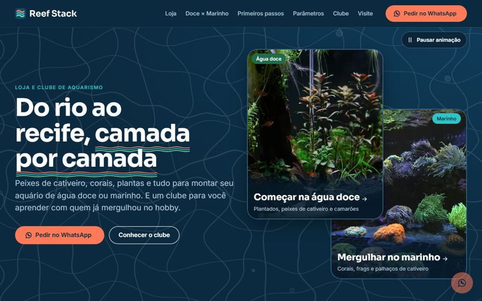
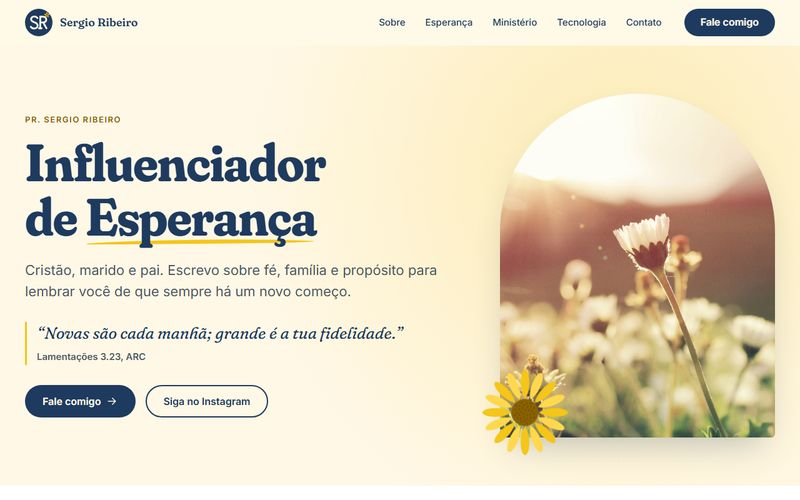
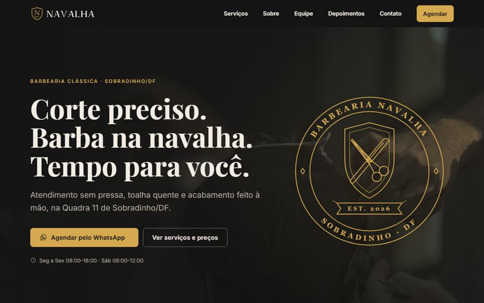
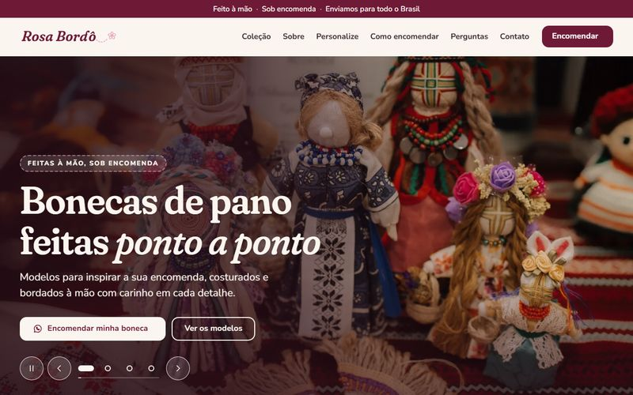
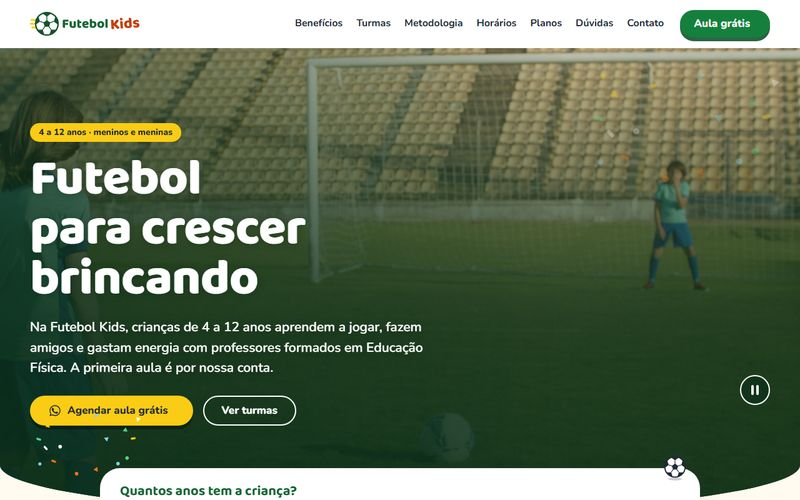
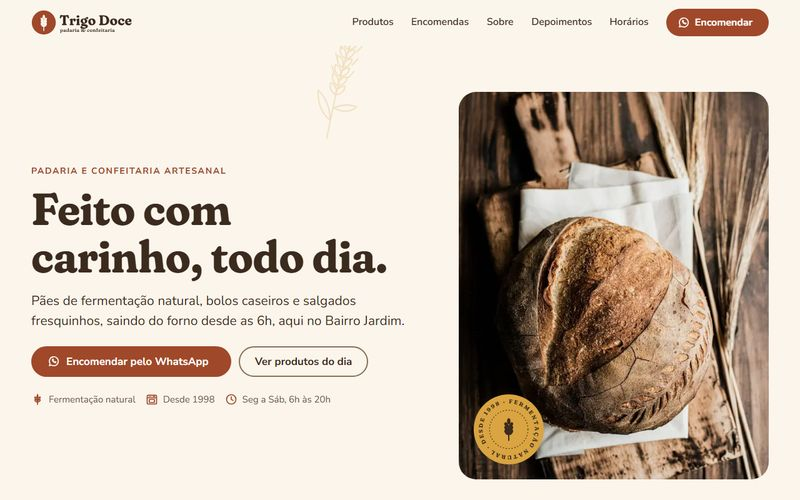
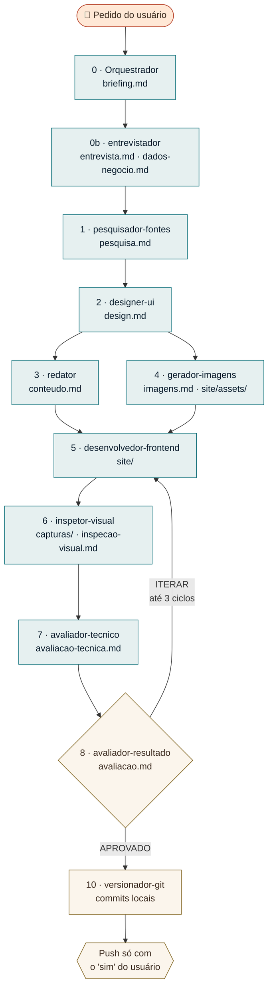

<div align="center">

# 🎨 Esquadrão Pixel

### Um time de agentes de IA que transforma um briefing em um site estático moderno, acessível e pronto para publicar


[](https://sergioribeirosilva.github.io/EsquadraoPixel/)

[Vitrine online](#-vitrine-online) •
[Projetos](#-projetos) •
[Como funciona](#%EF%B8%8F-como-funciona) •
[O time](#-o-time) •
[Stack](#%EF%B8%8F-stack) •
[Como usar](#-como-usar) •
[Qualidade](#-critérios-de-qualidade)

</div>

---

## 📌 Sobre

O **Esquadrão Pixel** é um conjunto de **subagentes do [Claude Code](https://claude.com/claude-code)** (definidos em [`.claude/agents/`](.claude/agents/)). Juntos, eles fazem o trabalho de uma pequena agência digital. A partir de um pedido simples, como *"crie uma landing page para a minha padaria"*, o time:

1. entende o negócio e levanta os dados reais com o dono;
2. pesquisa referências, conteúdo técnico e boas práticas;
3. cria um design system próprio (paleta com contraste verificado, tipografia, tokens);
4. escreve toda a copy, otimizada para conversão e SEO;
5. produz SVGs originais e busca fotos reais de licença livre;
6. programa o site em **HTML, CSS e JavaScript puro**;
7. abre o site num navegador real, faz capturas e mede com o Lighthouse;
8. avalia o site técnica e visualmente e corrige o que for preciso, em até 3 ciclos;
9. versiona cada projeto aprovado com Git.

Todo o processo fica documentado em Markdown dentro de cada projeto, do briefing ao relatório de avaliação.

---

## 🌐 Vitrine online

Todos os sites estão publicados no **GitHub Pages**, numa vitrine com um card para cada projeto:

### 👉 [sergioribeirosilva.github.io/EsquadraoPixel/](https://sergioribeirosilva.github.io/EsquadraoPixel/)

Cada site fica numa subpasta com o nome do projeto, por exemplo [`/rosa-bordo/`](https://sergioribeirosilva.github.io/EsquadraoPixel/rosa-bordo/).

**Como a publicação funciona**

1. Um push no `main` que mude algum `projetos/*/site/`, a pasta `vitrine/` ou o workflow dispara o [`pages.yml`](.github/workflows/pages.yml).
2. O workflow gera as capas que faltam com o [`vitrine/gerar_capas.py`](vitrine/gerar_capas.py) e roda o [`vitrine/montar.py`](vitrine/montar.py), que copia cada `projetos/<nome>/site/` para `_publicar/<nome>/` (sem os `.md`) e gera a página da vitrine a partir do [`vitrine/modelo.html`](vitrine/modelo.html), lendo o `<title>` e a `<meta name="description">` de cada site.
3. A pasta `_publicar/` é enviada ao GitHub Pages. Em cerca de 1 minuto o site novo está no ar.

**Projeto novo** entra na vitrine sozinho, sem editar nenhum arquivo, e a **capa** do card também é automática. Ela é gerada em dois momentos:

| Quando | Quem | O que acontece |
|---|---|---|
| O projeto é aprovado (etapa 10) | `versionador-git` | Roda `python vitrine/gerar_capas.py <nome>`, confere a imagem e inclui `vitrine/capas/<nome>.webp` e `.jpg` no commit. A capa fica no repositório e pode ser usada neste README. |
| A vitrine é publicada | workflow `pages.yml` | Antes de montar a vitrine, roda `vitrine/gerar_capas.py` e cria **só as capas que faltam** (por exemplo, de um site que não passou pelo Esquadrão). Essas capas existem só na publicação. |

O [`gerar_capas.py`](vitrine/gerar_capas.py) abre o `site/index.html` no Chrome ou no Edge sem janela, captura a primeira dobra em 1280×800 e reduz para 800×500. Para usar no seu computador (precisa do Pillow: `pip install pillow`):

```bash
python vitrine/gerar_capas.py               # gera só as capas que faltam
python vitrine/gerar_capas.py rosa-bordo    # refaz a capa de um projeto
python vitrine/gerar_capas.py --todas       # refaz todas
```

> Os sites são demonstrações: vários usam contatos, depoimentos e fotos de exemplo. Isso está avisado no rodapé da vitrine e em cada projeto.

---

## 🖼 Projetos

<table>
  <tr>
    <td width="33%" valign="top">
      <a href="https://sergioribeirosilva.github.io/EsquadraoPixel/reef-stack/"></a>
      <h3>🐠 Reef Stack</h3>
      Loja e clube de aquarismo, de água doce e marinho.<br>
      <sub><b>Aprovado</b> · média 4,71 · Lighthouse A11y 100</sub><br>
      <sub><a href="https://sergioribeirosilva.github.io/EsquadraoPixel/reef-stack/">Ver online</a> · <a href="projetos/reef-stack/">Projeto</a></sub>
    </td>
    <td width="33%" valign="top">
      <a href="https://sergioribeirosilva.github.io/EsquadraoPixel/diaconia-catedral-baleia/"></a>
      <h3>⛪ Corpo Diaconal</h3>
      Corpo Diaconal da AD Catedral Baleia, em Brasília/DF.<br>
      <sub><b>Aprovado</b> · média 4,71 · Lighthouse A11y 100</sub><br>
      <sub><a href="https://sergioribeirosilva.github.io/EsquadraoPixel/diaconia-catedral-baleia/">Ver online</a> · <a href="projetos/diaconia-catedral-baleia/">Projeto</a></sub>
    </td>
    <td width="33%" valign="top">
      <a href="https://sergioribeirosilva.github.io/EsquadraoPixel/sergio-ribeiro/"></a>
      <h3>🌼 Pr. Sergio Ribeiro</h3>
      Site pessoal: fé, família e esperança.<br>
      <sub><b>Aprovado</b> · média 4,71 · Lighthouse A11y 100</sub><br>
      <sub><a href="https://sergioribeirosilva.github.io/EsquadraoPixel/sergio-ribeiro/">Ver online</a> · <a href="projetos/sergio-ribeiro/">Projeto</a></sub>
    </td>
  </tr>
  <tr>
    <td width="33%" valign="top">
      <a href="https://sergioribeirosilva.github.io/EsquadraoPixel/emmeline-croche/"></a>
      <h3>🧶 Emmeline Crochê</h3>
      Bolsas de crochê artesanais, sob encomenda.<br>
      <sub><b>Aprovado</b> · média 4,71</sub><br>
      <sub><a href="https://sergioribeirosilva.github.io/EsquadraoPixel/emmeline-croche/">Ver online</a> · <a href="projetos/emmeline-croche/">Projeto</a></sub>
    </td>
    <td width="33%" valign="top">
      <a href="https://sergioribeirosilva.github.io/EsquadraoPixel/barbearia-navalha/"></a>
      <h3>💈 Barbearia Navalha</h3>
      Barbearia clássica em Sobradinho/DF, com mapa interativo.<br>
      <sub><b>Aprovado com ressalvas</b> · média 4,71</sub><br>
      <sub><a href="https://sergioribeirosilva.github.io/EsquadraoPixel/barbearia-navalha/">Ver online</a> · <a href="projetos/barbearia-navalha/">Projeto</a></sub>
    </td>
    <td width="33%" valign="top">
      <a href="https://sergioribeirosilva.github.io/EsquadraoPixel/rosa-bordo/"></a>
      <h3>🪡 Rosa Bordô</h3>
      Bonecas de pano feitas à mão, com carrossel no topo.<br>
      <sub><b>Aprovado</b> · média 4,43</sub><br>
      <sub><a href="https://sergioribeirosilva.github.io/EsquadraoPixel/rosa-bordo/">Ver online</a> · <a href="projetos/rosa-bordo/">Projeto</a></sub>
    </td>
  </tr>
  <tr>
    <td width="33%" valign="top">
      <a href="https://sergioribeirosilva.github.io/EsquadraoPixel/futebol-kids/"></a>
      <h3>⚽ Futebol Kids</h3>
      Escolinha de futebol para crianças de 4 a 12 anos.<br>
      <sub><b>Aprovado</b> · média 4,43 · Lighthouse A11y 100</sub><br>
      <sub><a href="https://sergioribeirosilva.github.io/EsquadraoPixel/futebol-kids/">Ver online</a> · <a href="projetos/futebol-kids/">Projeto</a></sub>
    </td>
    <td width="33%" valign="top">
      <a href="https://sergioribeirosilva.github.io/EsquadraoPixel/arena-fight-sobradinho/"></a>
      <h3>🥊 Arena Fight Sobradinho</h3>
      Escola de MMA: Karatê, Muay Thai, Wrestling e Jiu-Jitsu.<br>
      <sub><b>Aprovado</b> · média 4,43</sub><br>
      <sub><a href="https://sergioribeirosilva.github.io/EsquadraoPixel/arena-fight-sobradinho/">Ver online</a> · <a href="projetos/arena-fight-sobradinho/">Projeto</a></sub>
    </td>
    <td width="33%" valign="top">
      <a href="https://sergioribeirosilva.github.io/EsquadraoPixel/padaria-trigo-doce/"></a>
      <h3>🥖 Padaria Trigo Doce</h3>
      Padaria e confeitaria artesanal, com encomendas pelo WhatsApp.<br>
      <sub><b>Protótipo de teste</b> · sem ciclo formal de avaliação</sub><br>
      <sub><a href="https://sergioribeirosilva.github.io/EsquadraoPixel/padaria-trigo-doce/">Ver online</a> · <a href="projetos/padaria-trigo-doce/">Projeto</a></sub>
    </td>
  </tr>
</table>

| Projeto | Ramo | Paleta | Tipografia | Status | Média |
|---|---|---|---|---|:---:|
| [Reef Stack](projetos/reef-stack/) | Loja e clube de aquarismo | Abismo, lagoa, musgo, coral | Sora + Inter | ✅ Aprovado (ciclo 2) | **4,71** |
| [Corpo Diaconal](projetos/diaconia-catedral-baleia/) | Ministério de igreja | Marinho, dourado, creme | Lora + Source Sans 3 | ✅ Aprovado (ciclo 2) | **4,71** |
| [Pr. Sergio Ribeiro](projetos/sergio-ribeiro/) | Site pessoal / ministério | Creme, azul-profundo, amarelo-sol | Fraunces | ✅ Aprovado (ciclo 2) | **4,71** |
| [Emmeline Crochê](projetos/emmeline-croche/) | Artesanato | Vinho, marsala, creme | Cormorant Garamond + Lato | ✅ Aprovado (ciclo 2) | **4,71** |
| [Barbearia Navalha](projetos/barbearia-navalha/) | Barbearia | Grafite e latão | Playfair Display + Inter | ✅ Aprovado com ressalvas (ciclo 3) | **4,71** |
| [Rosa Bordô](projetos/rosa-bordo/) | Artesanato (bonecas de pano) | Bordô, creme, rosa | Fraunces + Nunito | ✅ Aprovado (ciclo 2) | **4,43** |
| [Futebol Kids](projetos/futebol-kids/) | Escolinha de futebol infantil | Verde-gramado, amarelo-sol, azul-céu | Baloo 2 + Nunito | ✅ Aprovado (ciclo 2) | **4,43** |
| [Arena Fight Sobradinho](projetos/arena-fight-sobradinho/) | Academia de MMA | Preto e vermelho | Barlow Condensed + Inter | ✅ Aprovado | **4,43** |
| [Padaria Trigo Doce](projetos/padaria-trigo-doce/) | Padaria | Creme, café, terracota, mel | Fraunces + Nunito Sans | 🧪 Protótipo | — |

> Cada pasta de projeto tem o próprio `README.md`, com capturas, design system, seções, avaliação e pendências.

---

## ⚙️ Como funciona

A sessão principal do Claude Code faz o papel de **orquestrador**. Ela recebe o pedido, grava o briefing e chama cada agente na ordem certa. Cada etapa grava arquivos em `projetos/<site>/`, e a etapa seguinte lê esses arquivos. Assim nada depende da memória da conversa.



**Regras do fluxo:**

- ⚡ **Paralelismo:** depois do design, o `redator` e o `gerador-imagens` rodam ao mesmo tempo.
- 🔁 **Iteração:** se a avaliação pedir correções, o fluxo volta ao redator (se houver ajuste de texto) e ao desenvolvedor, e depois repete a inspeção e as duas avaliações. São no máximo 3 ciclos.
- 🗺️ **Mapa:** se houver coordenadas reais, o site ganha um mapa interativo do Google. Com dados fictícios, não há mapa, para não apontar para um endereço de terceiros.
- 🔒 **Nada é publicado** nem enviado a serviços externos sem a confirmação explícita do usuário.

---

## 👥 O time

| # | Agente | Papel | Entrega |
|:-:|---|---|---|
| 0b | [`entrevistador`](.claude/agents/entrevistador.md) | Levanta os dados reais do negócio em duas fases, PREPARAR e CONSOLIDAR | `entrevista.md`, `dados-negocio.md` |
| 1 | [`pesquisador-fontes`](.claude/agents/pesquisador-fontes.md) | Pesquisa referências, conteúdo, acessibilidade e boas práticas, sempre com fonte | `pesquisa.md` |
| 2 | [`designer-ui`](.claude/agents/designer-ui.md) | Define conceito, paleta com contraste calculado, tipografia, tokens, grid e layout | `design.md` |
| 3 | [`redator`](.claude/agents/redator.md) | Escreve toda a copy: títulos, CTAs, FAQ, microtextos, SEO e textos alternativos | `conteudo.md` |
| 4 | [`gerador-imagens`](.claude/agents/gerador-imagens.md) | Cria SVGs originais e busca fotos reais de licença livre, com crédito | `imagens.md`, `site/assets/` |
| 5 | [`desenvolvedor-frontend`](.claude/agents/desenvolvedor-frontend.md) | Programa o site em HTML, CSS e JS puro, semântico e responsivo | `site/` |
| 6 | [`inspetor-visual`](.claude/agents/inspetor-visual.md) | Abre o site no Edge ou Chrome sem janela, faz capturas e roda o Lighthouse | `capturas/`, `inspecao-visual.md` |
| 7 | [`avaliador-tecnico`](.claude/agents/avaliador-tecnico.md) | Audita HTML, WCAG AA, responsividade, desempenho e SEO | `avaliacao-tecnica.md` |
| 8 | [`avaliador-resultado`](.claude/agents/avaliador-resultado.md) | Compara o site com o briefing e decide entre **APROVADO** e **ITERAR** | `avaliacao.md` |
| 10 | [`versionador-git`](.claude/agents/versionador-git.md) | Faz os commits do projeto aprovado e prepara o push | histórico Git |

---

## 🛠️ Stack

| Camada | Tecnologia | Por quê |
|---|---|---|
| Marcação | **HTML5 semântico** | Acessibilidade e SEO desde a base: `header`, `nav`, `main`, `section`, `footer` e um único `h1` |
| Estilo | **CSS3 puro**: custom properties (tokens), Grid, Flexbox, `clamp()` | Design system em variáveis, layout fluido e mobile-first, sem pré-processador |
| Interação | **JavaScript puro (ES6+)** | Menu acessível, abas WAI-ARIA, links de WhatsApp montados a partir de uma única constante, pausa de animação |
| Fontes | Google Fonts, ou fontes hospedadas no próprio site (`woff2` + `preload`) | No máximo 2 famílias por projeto |
| Imagens | **SVG** otimizado + **WebP/JPG** com `srcset` e `<picture>` | Leveza e nitidez em qualquer tela |
| Dados estruturados | **JSON-LD** (schema.org) | Rich results quando os dados são reais |
| Contato | Links `wa.me` com mensagem pré-codificada, `tel:` e `mailto:` | Conversão sem backend |
| Mapas | iframe do Google Maps (`loading="lazy"`) | Só com coordenadas reais |
| QA | Edge/Chrome sem janela, **Playwright** (`playwright-core`), **Lighthouse**, `html-validate` | Evidência visual e métricas reais |
| Orquestração | **Claude Code** + subagentes em Markdown | Processo reproduzível e documentado |
| Versionamento | **Git** + GitHub | Um commit por fase lógica de cada projeto aprovado |

> **Zero dependências de produção.** Não há framework, bundler nem `npm install` para rodar os sites. Basta abrir o `index.html`.

---

## 📁 Estrutura do repositório

```text
.
├── .claude/
│   └── agents/                 # definições dos 10 agentes do Esquadrão
├── .github/
│   └── workflows/pages.yml     # publica a vitrine no GitHub Pages
├── CLAUDE.md                   # regras do orquestrador e convenções do time
├── README.md                   # este arquivo
├── vitrine/
│   ├── modelo.html             # página-índice da vitrine
│   ├── montar.py               # copia os sites e gera os cards
│   ├── gerar_capas.py          # tira as capas dos sites (Chrome/Edge sem janela)
│   └── capas/                  # capa 800×500 de cada site (WebP + JPEG)
└── projetos/
    └── <nome-do-site>/
        ├── README.md           # visão geral do projeto
        ├── briefing.md         # etapa 0  — pedido e premissas
        ├── entrevista.md       # etapa 0b — roteiro e respostas
        ├── dados-negocio.md    # etapa 0b — contatos (reais ou fictícios)
        ├── pesquisa.md         # etapa 1  — referências com fonte
        ├── design.md           # etapa 2  — design system e layout
        ├── conteudo.md         # etapa 3  — toda a copy do site
        ├── imagens.md          # etapa 4  — créditos e licenças
        ├── site/               # etapa 5  — o site pronto
        │   ├── index.html
        │   ├── styles.css
        │   ├── script.js
        │   ├── CHANGELOG.md
        │   └── assets/
        ├── capturas/           # etapa 6  — capturas de tela da inspeção
        ├── inspecao-visual.md  # etapa 6
        ├── avaliacao-tecnica.md# etapa 7
        ├── avaliacao.md        # etapa 8  — decisão APROVADO/ITERAR
        └── docs/               # capturas usadas nos READMEs
```

> Os projetos mais antigos foram feitos antes de algumas etapas existirem. Por isso nem todos têm `conteudo.md`, `capturas/` ou `inspecao-visual.md`.

---

## 🚀 Como usar

### Ver um site pronto

O jeito mais rápido é abrir a [vitrine online](https://sergioribeirosilva.github.io/EsquadraoPixel/). Para ver no seu computador:

```bash
git clone https://github.com/SergioRibeiroSilva/EsquadraoPixel.git
cd EsquadraoPixel/projetos/reef-stack/site
# Opção 1: dê duplo clique em index.html
# Opção 2: sirva a pasta localmente
python -m http.server 8080      # e abra http://localhost:8080
```

### Pedir um site novo ao Esquadrão

1. Abra a pasta do repositório no **Claude Code** (CLI, VS Code ou desktop).
2. Faça o pedido em linguagem natural, por exemplo:
   > *"Peça ao Esquadrão Pixel para criar uma landing page para a minha clínica de fisioterapia em Goiânia."*
3. Responda de uma vez só às perguntas do `entrevistador`. Em qualquer item, pode responder *"use padrões"* ou *"fictícios por enquanto"*.
4. Acompanhe as etapas. No fim você recebe o caminho do `index.html`, as notas da avaliação e a lista de pendências.
5. Autorize, ou não, o push para o GitHub. Com o push, o site novo aparece na vitrine online.

### Pré-requisitos

- [Claude Code](https://claude.com/claude-code), para gerar novos sites
- Microsoft Edge ou Google Chrome, para a inspeção visual
- Node.js (opcional), para o Lighthouse e o Playwright via `npx`
- Git

---

## ✅ Critérios de qualidade

O `avaliador-resultado` dá nota de 1 a 5 a sete critérios. O site só é **APROVADO** com **média ≥ 4,0** e **nenhum critério abaixo de 3**:

| Critério | O que é avaliado |
|---|---|
| Aderência ao briefing | Objetivo, público, seções e CTA principal |
| Hierarquia e clareza | Leitura em "F", foco no CTA, escaneabilidade |
| Estética moderna | Coerência visual, respiro, detalhes de acabamento |
| Coerência com o design | Fidelidade ao `design.md` (tokens, tipografia, layout) |
| Qualidade do texto | Tom de voz, clareza, ortografia, precisão |
| Imagens e assets | Relevância, licenças, peso e nitidez |
| Experiência mobile | Menu, toque (alvos ≥ 44 px), legibilidade e desempenho |

**Lições já incorporadas ao processo:**

- nada de `backdrop-filter` no cabeçalho que contém o menu fixo, porque isso prende o painel do menu no celular;
- tabelas viram cartões empilhados abaixo de 600 px;
- a pasta `site/` precisa ter todos os assets dentro dela, para ser publicada sozinha;
- o número do WhatsApp fica numa única constante, para trocar num lugar só;
- todo dado fictício ou não confirmado leva um selo visível e um comentário no HTML;
- animações respeitam `prefers-reduced-motion` e têm botão de pausa.

---

## 📸 Imagens e licenças

- As **fotos** vêm só de **Unsplash, Pexels, Pixabay e Wikimedia Commons** (CC0, CC BY ou a licença do próprio banco). O `imagens.md` de cada projeto registra o autor, a licença e a URL de cada foto, e os créditos obrigatórios aparecem no rodapé do site.
- Fotos de pessoas, como equipe e depoimentos, são **ilustrativas** e estão marcadas como *"substituir antes de publicar"*.
- **SVGs** (logos, ícones, divisores, ilustrações) são originais, criados pelo time.
- Logotipos e conteúdo de terceiros **não são copiados**. Sites de referência servem só de inspiração de padrões.

---

## 🧭 Convenções

- Idioma padrão do conteúdo: **português do Brasil**.
- Nomes de arquivos e pastas em **kebab-case**, sem acentos.
- Commits no padrão **Conventional Commits**, com o escopo do projeto. Ex.: `feat(reef-stack): adiciona site validado no ciclo 2`.
- Sem frameworks nem build, salvo pedido explícito.

---

<div align="center">

Feito com 🤖 **Claude Code** e muito ☕ por **Sergio Ribeiro**

<sub>Os sites deste repositório são demonstrações. Dados marcados como fictícios ou "a confirmar" precisam ser revisados antes de qualquer publicação.</sub>

</div>
