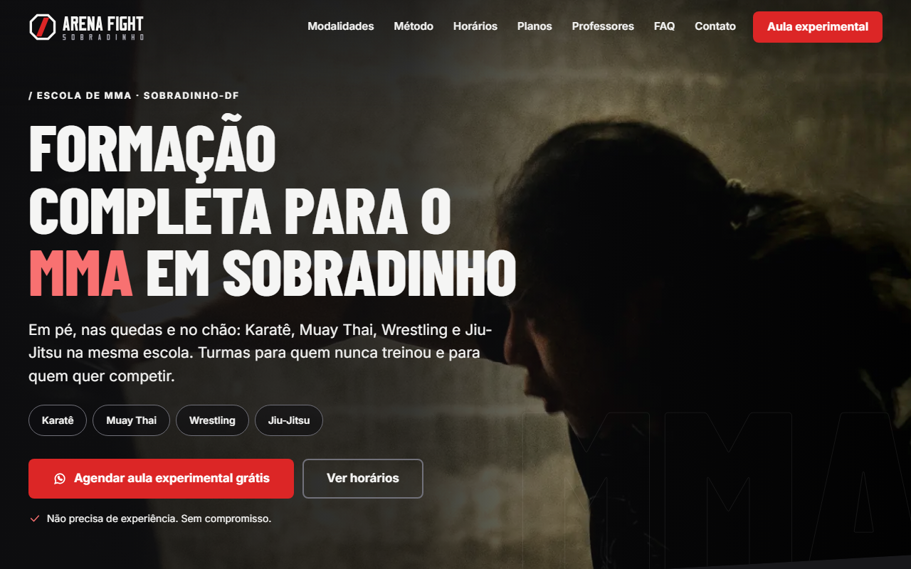
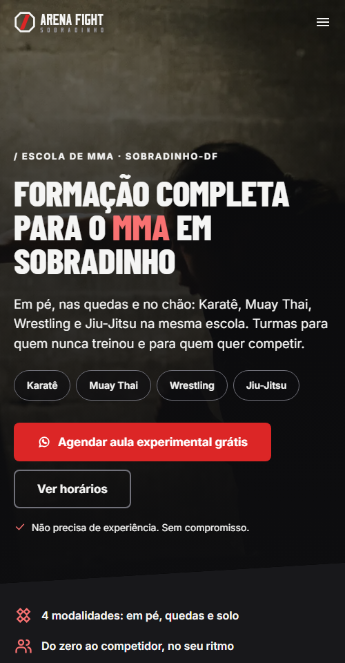

<div align="center">

# 🥊 Arena Fight Sobradinho

### Escola de MMA em Sobradinho-DF · Karatê, Muay Thai, Wrestling e Jiu-Jitsu

*"Formação completa para o MMA em Sobradinho"*


</div>

<table>
  <tr>
    <td width="74%"></td>
    <td width="26%"></td>
  </tr>
  <tr>
    <td align="center"><sub>Desktop · 1280 px</sub></td>
    <td align="center"><sub>Celular</sub></td>
  </tr>
</table>

---

## 📌 Sobre

Landing page de uma escola de artes marciais voltada ao **MMA**, com quatro modalidades que se completam e cobrem todas as fases da luta:

| Modalidade | Fase da luta |
|---|---|
| 🥋 **Karatê** | Trocação e controle de distância |
| 🦵 **Muay Thai** | Trocação e clinch |
| 🤼 **Wrestling** | Quedas e controle |
| 🥋 **Jiu-Jitsu** | Luta de solo e finalizações |

| | |
|---|---|
| **Pedido original** | "Landpage para uma escola de artes marciais voltada para o MMA em Sobradinho-DF…" (depois: "insira o jiu-jitsu") |
| **Público** | Jovens e adultos de 14 a 40 anos, do iniciante ao competidor, mais a turma kids/teen |
| **Tom de voz** | Enérgico, motivador, direto e respeitoso, sem agressividade gratuita |
| **CTA principal** | Agendar aula experimental grátis (WhatsApp) |

---

## 🧭 Seções

1. **Hero** de alto contraste com as 4 modalidades e o CTA de aula experimental
2. **Modalidades**: "Quatro artes, um lutador completo"
3. **Método**: "Do primeiro treino ao primeiro combate"
4. **Diferenciais**: "Treino sério, ambiente acolhedor"
5. **Grade de aulas** por modalidade
6. **Planos**: "Escolha seu ritmo"
7. **Professores**: "Quem vai te treinar"
8. **Depoimentos**: "Quem treina, recomenda"
9. **Perguntas frequentes**
10. **Localização**: "Venha treinar em Sobradinho"
11. **CTA final**: "Sua primeira aula é grátis"
12. **Rodapé** com contato e redes

---

## 🎨 Design system

**Conceito:** estética esportiva de academia de luta. Fundo preto e grafite, vermelho intenso, tipografia condensada e pesada, fotos de treino com alto contraste e recortes diagonais.

| Cor | Token | Hex | Uso |
|:-:|---|---|---|
|  | `--c-bg` | `#0E0E10` | Fundo |
|  | `--c-surface` | `#18181B` | Superfícies |
|  | `--c-text` | `#F5F5F4` | Texto |
|  | `--c-red` | `#DC2626` | CTA e destaques |
|  | `--c-red-light` | `#F87171` | Destaque em texto sobre o escuro |

**Tipografia:** [Barlow Condensed](https://fonts.google.com/specimen/Barlow+Condensed) nos títulos e [Inter](https://fonts.google.com/specimen/Inter) no texto.

---

## 📊 Avaliação

**Decisão final: ✅ APROVADO depois de 1 ciclo de correção**, com média **4,43** (31/35).

No primeiro ciclo a média foi 4,0, mas o critério mobile ficou abaixo de 3. Com a correção do bloqueante B1, a nota subiu e o site foi aprovado.

Relatórios: [`avaliacao-tecnica.md`](avaliacao-tecnica.md) · [`avaliacao.md`](avaliacao.md)

---

## 🚀 Como abrir

```bash
cd projetos/arena-fight-sobradinho/site
# duplo clique em index.html, ou:
python -m http.server 8080   # http://localhost:8080
```

---

## 📁 Arquivos do projeto

| Arquivo | Etapa | Conteúdo |
|---|---|---|
| [`briefing.md`](briefing.md) | 0 | Pedido e premissas ([ASSUMIDO]) |
| [`entrevista.md`](entrevista.md) | 0b | Roteiro de perguntas |
| [`pesquisa.md`](pesquisa.md) | 1 | Referências |
| [`design.md`](design.md) | 2 | Design system |
| [`imagens.md`](imagens.md) | 4 | Créditos e licenças |
| [`assets/`](assets/) | 4 | SVGs e fotos |
| [`site/`](site/) | 5 | `index.html`, `styles.css`, `script.js`, [`CHANGELOG.md`](site/CHANGELOG.md) |

---

## ⚠️ Pendências antes de publicar

- [ ] **Nome real** da escola e logo (o nome atual é provisório)
- [ ] **Dados reais**: WhatsApp (hoje o fictício `5561900000000` em todos os links), endereço, e-mail, redes e horário de funcionamento
- [ ] **Coordenadas**: o iframe do mapa está pronto, só falta trocar `LAT,LNG`
- [ ] **Conteúdo real**: grade de horários, planos e preços, professores e depoimentos (hoje exemplos)
- [ ] **Fotos reais** dos treinos, da estrutura e da equipe
- [ ] **Domínio**: `canonical`, `og:url` e `og:image`

---

## 📸 Créditos

As fotos vêm de Unsplash e Pexels e são ilustrativas. Os SVGs são originais. Os detalhes estão em [`imagens.md`](imagens.md).

<div align="center"><sub>Parte do <a href="../../README.md">Esquadrão Pixel</a></sub></div>
