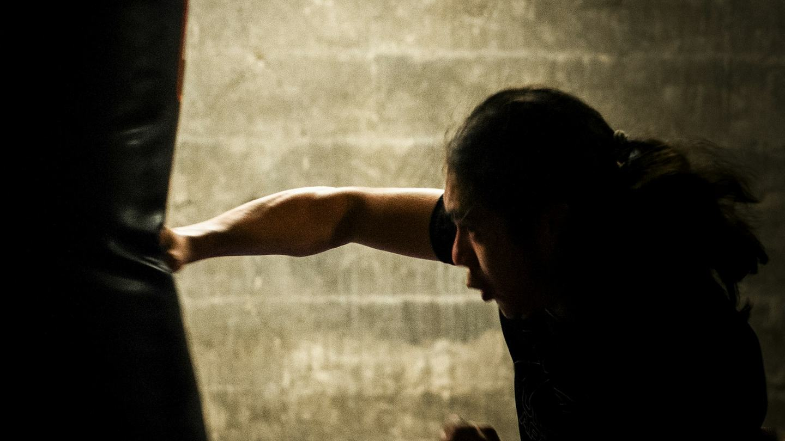

# Imagens: Arena Fight Sobradinho

> Etapa 3 (gerador-imagens), 2026-11-15. Entrada: `design.md`, seção 7 (F1 a F14 e S1 a S11).
> Todas as fotos são reais, de bancos públicos com licença livre para uso comercial (Unsplash License e Pexels License: uso gratuito, inclusive comercial, **sem atribuição obrigatória**). Nenhuma é CC BY, então o rodapé não precisa de crédito. Os créditos ficam registrados aqui.
> Download em 2026-11-15. Recorte e compressão feitos com Pillow. Cada foto existe em **JPG (progressivo) + WebP** com o mesmo nome.
> Caminhos relativos a `site/assets/`. A partir de `site/index.html`, use `assets/...`.

## 1. Fotos

| # | Arquivo(s) | Uso | Dimensões / peso (JPG · WebP) | Banco · autor · URL | Original | `alt` sugerido | Status |
|---|---|---|---|---|---|---|---|
| F1 | `fotos/hero-treino-1920` · `-1440` · `-960` | Hero desktop (16:9) | 1920×1080 221·159 KB · 1440×810 99·52 KB · 960×540 38·14 KB | Unsplash · Pete Alexopoulos · https://unsplash.com/photos/a-woman-is-punching-a-punching-bag-in-a-dark-room-la3cBBjHImk | 3845×4016 | `alt=""` (decorativa, conforme design 3.2) | pronto |
| F1m | `fotos/hero-treino-mobile` | Hero mobile (4:5) | 900×1125 · 73·28 KB | (mesma foto do F1) | n/a | `alt=""` | pronto |
| F2 | `fotos/modalidade-karate-1200` · `-800` | Card Karatê (16:10) | 1200×750 66·21 KB · 800×500 33·11 KB | Unsplash · Nguyen Hung · https://unsplash.com/photos/a-man-holding-his-hands-together-iVTl2SylXG0 | 6240×4160 | "Karateca de kimono branco em posição de guarda" | pronto |
| F3 | `fotos/modalidade-muay-thai-1200` · `-800` | Card Muay Thai (16:10) | 1200×750 148·97 KB · 800×500 87·61 KB | Unsplash · Antonio Araujo · https://unsplash.com/photos/a-couple-of-men-standing-next-to-each-other-in-a-gym-j_7Rd7uFl_g | 6000×4000 | "Dois alunos treinando chute e bloqueio de Muay Thai em academia com sacos de pancada vermelhos" | pronto |
| F4 | `fotos/modalidade-wrestling-1200` · `-800` | Card Wrestling (16:10) | 1200×750 84·31 KB · 800×500 43·18 KB | Unsplash · Nathan Dumlao · https://unsplash.com/photos/AsCCBr7J-XM | 5321×7978 | "Dois atletas em pé no tatame disputando a pegada antes de uma queda" | pronto |
| F5 | `fotos/modalidade-jiu-jitsu-1200` · `-800` | Card Jiu-Jitsu (16:10) | 1200×750 98·41 KB · 800×500 51·25 KB | Unsplash · Samuel Castro · https://unsplash.com/photos/MS_RP-Lba0U | 4291×2861 | "Dois praticantes de Jiu-Jitsu de quimono trabalhando a guarda no tatame" | pronto |
| F6 | `fotos/ambiente-academia` | Diferenciais desktop (4:5) | 1080×1350 · 206·158 KB | Unsplash · Anastase Maragos · https://unsplash.com/photos/man-training-muay-thai-with-a-punching-bag-K8s0zMOPo8A | 4847×7267 | "Academia de luta com tatame, sacos de pancada e alunos treinando" | pronto (ver obs. 2) |
| F6m | `fotos/ambiente-academia-mobile` | Diferenciais mobile (16:10) | 1200×750 · 153·99 KB | (mesma foto do F6) | n/a | idem F6 | pronto |
| F7 | `fotos/primeira-aula` | "Sua primeira aula" (4:3) | 1200×900 · 144·78 KB | Unsplash · MARK ADRIANE · https://unsplash.com/photos/two-men-sparring-inside-boxing-gym-FH6JcaCrYJ0 | 5543×3695 | "Professor segurando a manopla para um aluno treinar socos" | pronto |
| F8 | `equipe/professor-karate` | Professores (4:5) | 800×1000 · 55·22 KB | Unsplash · Nguyen Hung · https://unsplash.com/photos/a-man-in-a-karate-uniform-n5sr9hpCCOs | 4160×6240 | "Foto ilustrativa de professor de Karatê" | **substituir antes de publicar** |
| F9 | `equipe/professora-muay-thai` | Professores (4:5) | 800×1000 · 71·34 KB | Unsplash · Roman Aguila · https://unsplash.com/photos/a-woman-in-a-black-shirt-and-blue-gloves-Z4svqpRlucE | 5164×4672 | "Foto ilustrativa de professora de Muay Thai" | **substituir antes de publicar** |
| F10 | `equipe/professor-wrestling` | Professores (4:5) | 800×1000 · 86·32 KB | Unsplash · Lorenzo Fattò Offidani · https://unsplash.com/photos/man-in-black-tank-top-P6T1R9rSL0Q | 6000×4000 | "Foto ilustrativa de professor de Wrestling" | **substituir antes de publicar** |
| F11 | `equipe/professor-jiu-jitsu` | Professores (4:5) | 800×1000 · 48·19 KB | Pexels · Max Aretz · https://www.pexels.com/photo/martial-artist-in-black-gi-with-confident-pose-36763069/ | 4672×7008 | "Foto ilustrativa de professor de Jiu-Jitsu" | **substituir antes de publicar** |
| F12 | `depoimentos/depoimento-lucas` | Avatar depoimento (1:1) | 240×240 · 7·3 KB | Unsplash · Josias Garibay · https://unsplash.com/photos/a-smiling-young-man-in-a-dark-blue-sweater-rifCUO-4X8k | 6000×4000 | `alt=""` (nome ao lado; design 4.6). Se usar alt: "Foto ilustrativa" | **substituir antes de publicar** |
| F13 | `depoimentos/depoimento-ana` | Avatar depoimento (1:1) | 240×240 · 9·5 KB | Unsplash · Devin Santiago · https://unsplash.com/photos/a-woman-smiles-while-sitting-at-the-gym-s_BoAabXVmA | 6292×4289 | idem | **substituir antes de publicar** |
| F14 | `depoimentos/depoimento-marcos` | Avatar depoimento (1:1) | 240×240 · 5·2 KB | Unsplash · Christoph Aigner · https://unsplash.com/photos/a-smiling-man-with-arms-crossed-on-gray-background-vhj1DvszLZU | 5760×3840 | idem | **substituir antes de publicar** |

**Licenças**
- Unsplash License (https://unsplash.com/license): uso gratuito, comercial e não comercial, sem pedir permissão nem dar crédito. Não é permitido revender a foto sem modificação nem montar um serviço concorrente. Todas as fotos do Unsplash usadas aqui são gratuitas (nenhuma Unsplash+ ou Getty).
- Pexels License (https://www.pexels.com/license/): mesma lógica, com uso gratuito e atribuição opcional.
- As pessoas retratadas são reais, mas desconhecidas. **Professores e depoimentos são ilustrativos**: mantenha o selo "Substituir antes de publicar" / "Exemplo" e troque pelas fotos reais da equipe e de alunos (com autorização por escrito) antes de publicar.

**Observações para o desenvolvedor**
1. **Hero (F1):** o sujeito está no terço direito e o saco de pancada escuro à esquerda, o que deixa a área do texto escura por natureza. Use `object-position: 70% 40%` no desktop. No mobile, o recorte 4:5 já centraliza a atleta (`object-position: center top`). É treino de socos no saco (trocação), sem marcas legíveis. O recorte eliminou a marca impressa no saco.
2. **Ambiente (F6):** é uma academia real com tatame, sacos e alunos treinando Muay Thai, não um salão vazio. Foi a melhor opção escura e organizada disponível. O peso (206 KB JPG / 158 KB WebP) fica um pouco acima da meta de 180 KB por causa da textura. Sirva o WebP primeiro.
3. **Professores:** as fotos têm estilos diferentes (fundos preto, azul-petróleo e claro). O filtro `grayscale(100%) contrast(1.1)` do design (3.9) unifica o conjunto. Enquadramento sugerido: `object-fit: cover; object-position: center 20%`. O Prof. de Jiu-Jitsu usa quimono preto com faixa branca e listras. A marca do fabricante na manga é discreta e escura, e o texto do card já diz "Graduação: a informar".
4. **Wrestling (F4):** dois atletas de rash guard disputando a pegada (collar tie) em pé no tatame, em estúdio claro e sem logotipos. No card 16:10, use `object-position: center`.
5. **Avatares:** 240×240 para exibição a 56px (cobre telas 3x e mais).
6. Exemplo de `<picture>` para o hero:
   ```html
   <picture>
     <source media="(max-width: 767px)" type="image/webp" srcset="assets/fotos/hero-treino-mobile.webp">
     <source media="(max-width: 767px)" srcset="assets/fotos/hero-treino-mobile.jpg">
     <source type="image/webp" srcset="assets/fotos/hero-treino-960.webp 960w, assets/fotos/hero-treino-1440.webp 1440w, assets/fotos/hero-treino-1920.webp 1920w" sizes="100vw">
     
   </picture>
   ```

## 2. SVGs (gerados pelo time)

Todos validados como XML, sem fontes externas, scripts ou imagens embutidas, e todos abaixo de 4 KB. Cores apenas da paleta (`#0E0E10`, `#18181B`, `#232327`, `#3F3F46`, `#A1A1AA`, `#F5F5F4`, `#DC2626`) ou `currentColor`.

| # | Arquivo | Uso | Dimensões | Acessibilidade | Status |
|---|---|---|---|---|---|
| S1 | `logo-arena-fight.svg` | Header | viewBox ≈ 198×48 (altura 32px mobile / 40px desktop) | `role="img"` + `<title>`. No link, use `aria-label="Arena Fight Sobradinho, início"` e `alt=""` no `` | pronto |
| S2 | `logo-arena-fight-mono.svg` | Rodapé | ≈ 198×48 | Usa `currentColor`: precisa ser **inline no HTML** para herdar a cor (em `` fica preto). Alternativa: usar o S1 | pronto |
| S3 | `favicon.svg` | Favicon | 64×64 | `<link rel="icon" type="image/svg+xml" href="assets/favicon.svg">` | pronto |
| S4 | `og-image.svg` + `og-image.png` | Open Graph | 1200×630 (PNG de 20 KB, exportado via Chrome headless) | Use o PNG em `og:image`. O SVG usa texto com fallback Arial Narrow | pronto |
| S5 | `padrao-barras.svg` | CTA final (fundo) | tile 48×48, barras "/" pretas a 12% | decorativo (`background-image`, `background-size: 48px`) | pronto |
| S6 | `forma-corte-diagonal.svg` | Fallback do `clip-path` | 1440×72, `preserveAspectRatio="none"` | decorativo | pronto |
| S7 | `mapa-placeholder.svg` | Contato | 800×600 | `<title>` interno. Use `alt="Mapa ilustrativo: o mapa interativo será exibido quando o endereço real for confirmado"`. Já traz a frase central | pronto |
| S8 | `icone-professor.svg` · `icone-seguranca.svg` · `icone-niveis.svg` · `icone-preparo.svg` | Diferenciais | 24×24, traço 2px | `aria-hidden="true"`. Usam `currentColor`: inline ou via sprite para ficarem `--c-red-light` | pronto |
| S9 | `icone-modalidades.svg` · `icone-turmas.svg` · `icone-gratis.svg` | Faixa de prova | 24×24 | idem | pronto |
| S10 | `icones.svg` (sprite) | UI geral | 24×24 por símbolo | ids: `i-whatsapp`, `i-instagram`, `i-facebook`, `i-tiktok`, `i-local`, `i-relogio`, `i-telefone`, `i-email`, `i-check`, `i-menu`, `i-fechar`, `i-mais`, `i-seta`, `i-alerta`. Os ícones de redes são versões simplificadas de traço. O ideal é colar o conteúdo do sprite inline no topo do `<body>` e usar `<svg aria-hidden="true"><use href="#i-whatsapp"/></svg>`, porque `<use>` para arquivo externo não funciona em `file://` | pronto |
| S11 | `marca-k.svg` · `marca-mt.svg` · `marca-w.svg` · `marca-jj.svg` | Grade de horários e chips | 20×20, monograma em quadrado com canto chanfrado | `role="img"` + `<title>` (Karatê, Muay Thai, Wrestling, Jiu-Jitsu). Como o nome da modalidade aparece ao lado, prefira inline com `aria-hidden="true"`. Usam `currentColor` | pronto |

## 3. Pendências e lacunas

- **Nenhuma lacuna de foto.** Os 14 pedidos (F1 a F14) foram atendidos com fotos reais e livres, por isso não foi criado `assets/prompts-imagens.md`.
- Substituir antes de publicar: F8 a F11 (equipe real) e F12 a F14 (clientes reais, com autorização).
- Recomendado no futuro: foto real da fachada e do tatame da escola para trocar o F6.
