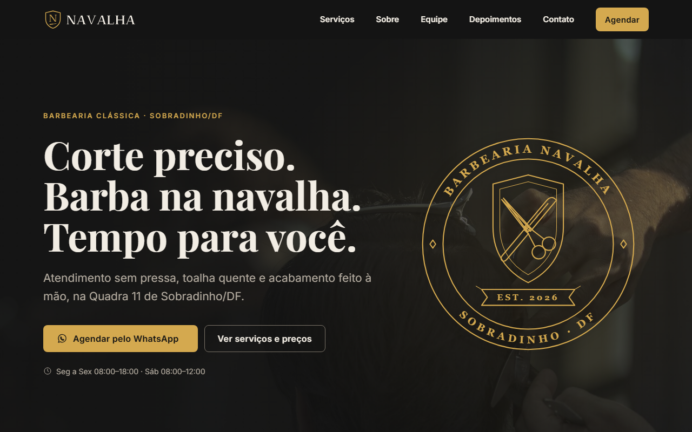
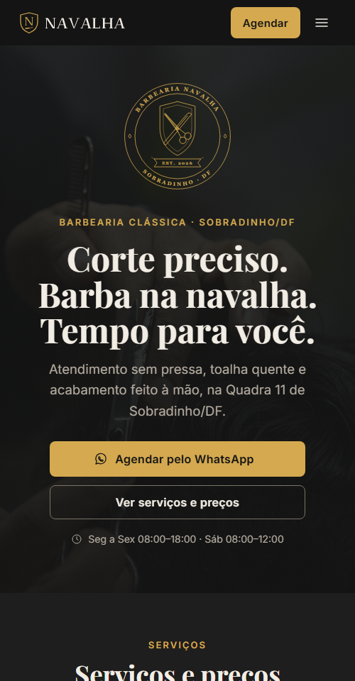

<div align="center">

# 💈 Barbearia Navalha

### Barbearia clássica em Sobradinho/DF

*"Corte preciso. Barba na navalha. Tempo para você."*


</div>

<table>
  <tr>
    <td width="74%"></td>
    <td width="26%"></td>
  </tr>
  <tr>
    <td align="center"><sub>Desktop · 1280 px</sub></td>
    <td align="center"><sub>Celular</sub></td>
  </tr>
</table>

---

## 📌 Sobre

Este foi o **primeiro projeto do Esquadrão Pixel**, usado para testar o fluxo de agentes de ponta a ponta. É a landing page de uma barbearia com estética moderna e raízes clássicas. O objetivo é levar o visitante a **agendar um horário pelo WhatsApp**.

Foi aqui que nasceram duas regras do time: a etapa de **entrevista de dados reais** e o **mapa interativo do Google** sempre que houver coordenadas.

| | |
|---|---|
| **Público** | Homens de 20 a 45 anos, urbanos, que valorizam estilo e bom atendimento |
| **Tom de voz** | Confiante, direto e acolhedor, com um toque clássico |
| **CTA principal** | Agendar pelo WhatsApp |
| **Dados** | Endereço, contato, horários e coordenadas **reais** (ver [`dados-negocio.md`](dados-negocio.md)). Textos, equipe, preços e depoimentos são exemplos |

---

## 🧭 Seções

1. **Hero** com brasão em SVG, chamada e horário de funcionamento
2. **Serviços e preços**: corte, barba, corte + barba, pigmentação, sobrancelha
3. **Sobre**: "Clássico no ritual, moderno no resultado"
4. **Equipe**: 3 barbeiros
5. **Depoimentos** (exemplos)
6. **Horários e localização**, com **mapa interativo do Google**
7. **CTA final**: "Sua cadeira está esperando"
8. **Rodapé** com contato e redes

---

## 🎨 Design system

**Conceito:** barbearia clássica com acabamento contemporâneo. Fundo grafite, latão dourado e tipografia serifada de alto contraste.

| Cor | Token | Hex | Uso |
|:-:|---|---|---|
|  | `--color-bg` | `#141414` | Fundo |
|  | `--color-surface` | `#1E1E1E` | Superfícies |
|  | `--color-text` | `#F2EDE4` | Texto principal |
|  | `--color-text-muted` | `#B5ADA1` | Texto de apoio |
|  | `--color-accent` | `#D4A94F` | Latão: CTAs e detalhes |

**Tipografia:** [Playfair Display](https://fonts.google.com/specimen/Playfair+Display) nos títulos e [Inter](https://fonts.google.com/specimen/Inter) no texto.

---

## 📊 Avaliação

**Decisão final: ✅ APROVADO COM RESSALVAS no ciclo 3 de 3**, com média **4,71** e nenhum critério abaixo de 4.

O caminho até a aprovação: no ciclo 1 a média foi 4,0, mas a nota de mobile ficou em 2 por causa do menu mobile quebrado. A correção levou a 4,71 no ciclo 3.

Relatórios: [`avaliacao-tecnica.md`](avaliacao-tecnica.md) · [`avaliacao.md`](avaliacao.md)

---

## 🚀 Como abrir

```bash
cd projetos/barbearia-navalha/site
# duplo clique em index.html, ou sirva a pasta do PROJETO:
cd .. && python -m http.server 8080   # http://localhost:8080/site/
```

> A pasta [`site/`](site/) tem todos os assets dentro dela e pode ser publicada sozinha.

---

## 📁 Arquivos do projeto

| Arquivo | Etapa | Conteúdo |
|---|---|---|
| [`briefing.md`](briefing.md) | 0 | Pedido e premissas |
| [`entrevista.md`](entrevista.md) | 0b | Roteiro e respostas |
| [`dados-negocio.md`](dados-negocio.md) | 0b | Dados de contato reais e coordenadas |
| [`pesquisa.md`](pesquisa.md) | 1 | Referências |
| [`design.md`](design.md) | 2 | Design system |
| [`imagens.md`](imagens.md) | 4 | Créditos, licenças e prompts de fotos |
| [`site/assets/`](site/assets/) | 4 | SVGs e fotos |
| [`site/`](site/) | 5 | `index.html`, `styles.css`, `script.js`, [`CHANGELOG.md`](site/CHANGELOG.md) |

---

## ⚠️ Pendências antes de publicar

- [ ] **Fotos reais** da equipe, do ambiente e dos clientes, com autorização de uso de imagem
- [ ] **Conteúdo real**: nomes e especialidades da equipe, preços e durações (revisar também o `priceRange` do JSON-LD) e depoimentos
- [ ] Tirar o aviso "Site de demonstração" e os selos "Exemplo" quando tudo for real
- [ ] **Logotipo definitivo**, se houver
- [ ] **Domínio**: `og:image` (1200x630), `og:url`, `canonical` e `url` no JSON-LD
- [ ] Conferir o menu mobile num iPhone real (Safari)

---

## 📸 Créditos

As fotos vêm de Unsplash e Wikimedia Commons e são ilustrativas. O brasão e os demais SVGs são originais. Os detalhes estão em [`imagens.md`](imagens.md).

<div align="center"><sub>Parte do <a href="../../README.md">Esquadrão Pixel</a></sub></div>
