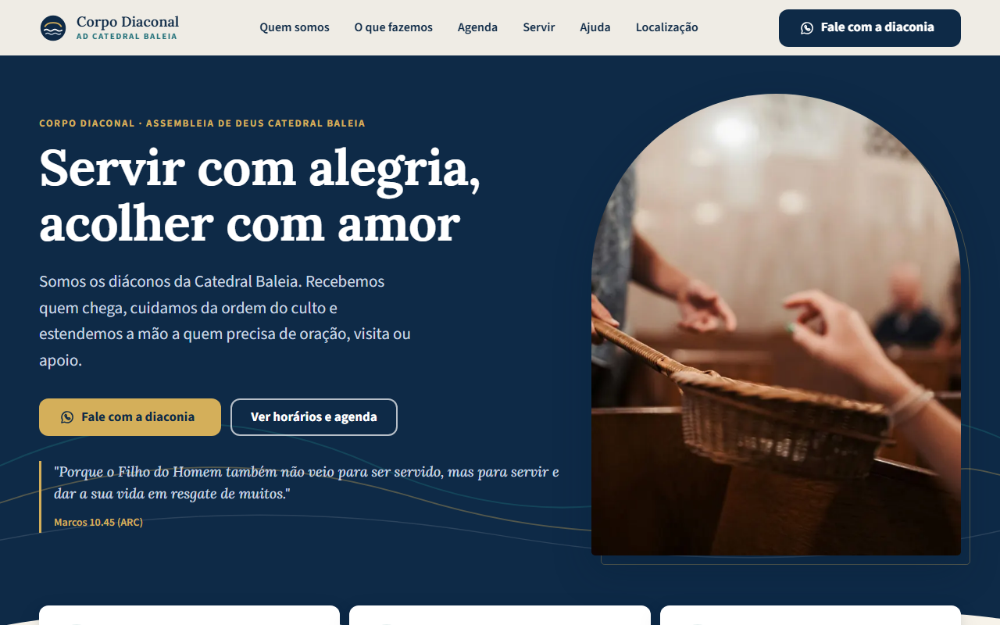
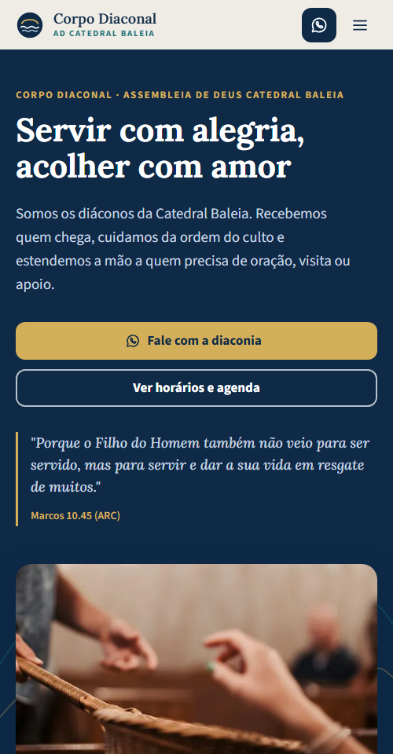

<div align="center">

# ⛪ Corpo Diaconal · AD Catedral Baleia

### Landing page do Corpo Diaconal da Assembleia de Deus Catedral Baleia, em Brasília/DF

*"Servir com alegria, acolher com amor"*


</div>

<table>
  <tr>
    <td width="74%"></td>
    <td width="26%"></td>
  </tr>
  <tr>
    <td align="center"><sub>Desktop · 1280 px</sub></td>
    <td align="center"><sub>Celular</sub></td>
  </tr>
</table>

---

## 📌 Sobre

A página apresenta o **Corpo Diaconal** da Catedral Baleia, sede nacional da **CONAMAD** (Assembleias de Deus Ministério de Madureira), na SGAS 910, Asa Sul. Ela mostra quem são os diáconos, o que fazem e a base bíblica do diaconato. Também abre três caminhos para a membresia: **falar com a diaconia**, **pedir ajuda** (oração, visita ou apoio social) e **servir junto**.

| | |
|---|---|
| **Pedido original** | "Landing page para o Corpo Diaconal de nossa igreja… O Esquadrão poderá encontrar mais informações na web" |
| **Público** | Membros, congregados, visitantes e irmãos interessados em servir |
| **Tom de voz** | Reverente, acolhedor e servidor, sem tom político |
| **CTA principal** | Fale com a diaconia (WhatsApp) |
| **Fonte dos dados** | Pesquisa pública na web; cada dado é marcado CONFIRMADO ou "a confirmar" |

---

## 🧭 Seções

1. **Hero** com versículo de destaque (Marcos 10.45, ARC) e faixa de informações rápidas
2. **Quem somos**, com foto real do templo (Wikimedia Commons)
3. **Base bíblica**: Atos 6.1-7, 1 Timóteo 3.8-13 e Filipenses 1.1
4. **Onde a diaconia serve**: 7 áreas de atuação
5. **Quem coordena o serviço**: liderança, com espaços reservados para os nomes
6. **Horários e escala**: agenda que vira cartões no celular
7. **Quer servir conosco?**: passos para ingressar
8. **Precisa de ajuda?**: formulário que monta a mensagem e abre o WhatsApp, sem guardar dados
9. **Dúvidas comuns**
10. **Venha nos visitar**: endereço e **mapa interativo do Google**
11. **Rodapé** com redes da igreja e créditos

---

## 🎨 Design system

**Conceito: "Serviço que acolhe como água mansa".** Ondas desenhadas do zero lembram o espelho d'água e a curva do templo em forma de baleia, e uma moldura em arco envolve a foto do hero. A página não usa silhueta literal de baleia nem o logotipo oficial.

| Cor | Token | Hex | Uso |
|:-:|---|---|---|
|  | `--cor-marinho` | `#0E2A47` | Cor principal e fundos escuros |
|  | `--cor-dourado` | `#D4AF5A` | Destaque **só sobre marinho** (7,0:1) |
|  | `--cor-dourado-escuro` | `#7C5E17` | Dourado sobre fundo claro (5,4:1) |
|  | `--cor-petroleo` | `#1F6F78` | Cor de destaque |
|  | `--cor-creme` | `#F7F3EA` | Fundo claro |

> Dourado sobre creme (~1,9:1) foi **proibido** no design por não passar no contraste.

**Tipografia:** [Lora](https://fonts.google.com/specimen/Lora) nos títulos e versículos, e [Source Sans 3](https://fonts.google.com/specimen/Source+Sans+3) no texto (17 px, escala fluida com `clamp`).

**Recursos de interface:**
- 🏷️ Selo visual **"a confirmar"** em cada dado não confirmado
- 🗺️ Mapa do Google em iframe, com `title` acessível e `loading="lazy"`
- 🧩 JSON-LD do tipo `Church`, com `url`, `image` e `logo`
- 💬 WhatsApp numa única constante (`WHATSAPP`), com 3 mensagens prontas
- 🖼️ `<picture>` com WebP e JPG, `srcset` de 640 e 1200 px

---

## 📊 Avaliação

**Decisão final: ✅ APROVADO no ciclo 2 de 3**, com média **4,71** (no ciclo 1 era 3,86, por causa do menu mobile).

| Critério | Nota |
|---|:-:|
| Aderência ao briefing | ⭐⭐⭐⭐⭐ 5 |
| Hierarquia e clareza | ⭐⭐⭐⭐⭐ 5 |
| Estética moderna | ⭐⭐⭐⭐⭐ 5 |
| Coerência com o design | ⭐⭐⭐⭐⭐ 5 |
| Qualidade do texto | ⭐⭐⭐⭐ 4 |
| Imagens e assets | ⭐⭐⭐⭐ 4 |
| Experiência mobile | ⭐⭐⭐⭐⭐ 5 |

**Lighthouse (celular, ciclo 2):** desempenho **91** · acessibilidade **100** · boas práticas **100** · SEO **100**

Relatórios completos: [`inspecao-visual.md`](inspecao-visual.md) · [`avaliacao-tecnica.md`](avaliacao-tecnica.md) · [`avaliacao.md`](avaliacao.md) · [`capturas/`](capturas/)

---

## 🚀 Como abrir

```bash
cd projetos/diaconia-catedral-baleia/site
# duplo clique em index.html, ou:
python -m http.server 8080   # http://localhost:8080
```

A pasta [`site/`](site/) tem todos os assets dentro dela e pode ser publicada sozinha.

---

## 📁 Arquivos do projeto

| Arquivo | Etapa | Conteúdo |
|---|---|---|
| [`briefing.md`](briefing.md) | 0 | Pedido, premissas e correções da pesquisa |
| [`entrevista.md`](entrevista.md) | 0b | Roteiro e respostas ("siga com o que encontrar") |
| [`dados-negocio.md`](dados-negocio.md) | 0b | Dados públicos marcados CONFIRMADO ou A CONFIRMAR |
| [`pesquisa.md`](pesquisa.md) | 1 | Dados da igreja com fonte, base bíblica, referências |
| [`design.md`](design.md) | 2 | Design system completo |
| [`conteudo.md`](conteudo.md) | 3 | Toda a copy do site |
| [`imagens.md`](imagens.md) | 4 | Créditos e licenças |
| [`site/`](site/) | 5 | `index.html`, `styles.css`, `script.js`, [`CHANGELOG.md`](site/CHANGELOG.md) |

---

## ⚠️ Pendências antes de publicar

- [ ] **WhatsApp**: o número encontrado, (61) 9905-5252, tem só 8 dígitos e talvez seja (61) 99905-5252
- [ ] **Liderança**: nomes do coordenador e dos diáconos, com autorização (hoje "[Nome do …]")
- [ ] **Pastor presidente**: autorização para citar "Pr. João Adair Ferreira"
- [ ] **A confirmar**: CEP (70390-100), telefone fixo, e-mail, Instagram, horários dos cultos e coordenadas do mapa
- [ ] **Diaconia**: confirmar as 7 áreas de atuação e os passos de ingresso
- [ ] **Versículos**: conferir na ARC Mc 10.45, At 6.3, 1 Pe 4.10 e Gl 6.2
- [ ] **Fotos reais** da diaconia e uma foto atual da fachada (as do Commons são de 2011–2012, antes da reinauguração de 2015)
- [ ] **Domínio**: substituir `https://SEU-DOMINIO/`

---

## 📸 Créditos

A foto do templo é de **Josue Marinho**, via Wikimedia Commons, licença **CC BY 3.0** (recortada). As demais fotos vêm de Unsplash e Pexels e são ilustrativas. Os SVGs são originais. Os detalhes estão em [`imagens.md`](imagens.md).

<div align="center"><sub>Parte do <a href="../../README.md">Esquadrão Pixel</a></sub></div>
