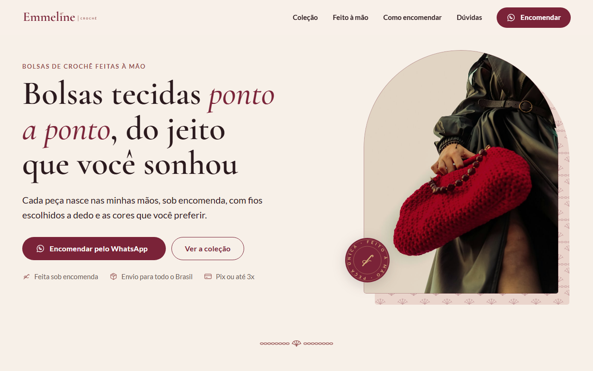
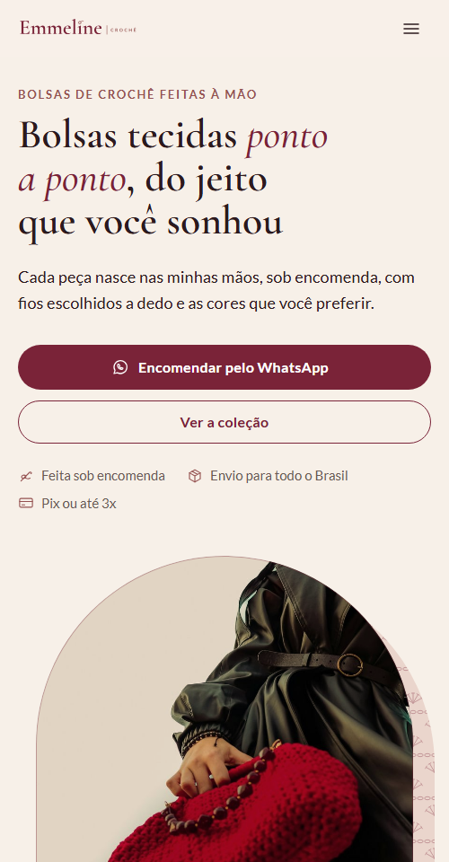

<div align="center">

# 🧶 Emmeline Crochê

### Bolsas de crochê feitas à mão, sob encomenda

*"Bolsas tecidas ponto a ponto, do jeito que você sonhou"*


</div>

<table>
  <tr>
    <td width="74%"></td>
    <td width="26%"></td>
  </tr>
  <tr>
    <td align="center"><sub>Desktop · 1280 px</sub></td>
    <td align="center"><sub>Celular</sub></td>
  </tr>
</table>

---

## 📌 Sobre

Landing page de uma artesã que faz **bolsas de crochê exclusivas**. O visual elegante, em **tons de vinho**, valoriza o feito à mão. A página leva a visitante a **encomendar uma bolsa pelo WhatsApp**.

| | |
|---|---|
| **Pedido original** | "Landing page para a Emmeline. Ela apresenta bolsas de crochê e suas cores são próximas da cor vinho" |
| **Público** | Mulheres de 25 a 55 anos que valorizam peças artesanais e exclusivas |
| **Tom de voz** | Acolhedor, delicado e sofisticado, em primeira pessoa (a voz da artesã) |
| **CTA principal** | Encomendar pelo WhatsApp |
| **CTA secundário** | Ver a coleção / Instagram |

---

## 🧭 Seções

1. **Hero** com chamada, foto em arco e selos (sob encomenda, envio para todo o Brasil, Pix ou até 3x)
2. **Coleção**: vitrine com 6 modelos e faixa de preço "a partir de"
3. **O feito à mão**: história, processo e materiais
4. **Como encomendar**: escolha, personalização, produção e entrega
5. **Diferenciais**
6. **Depoimentos** (exemplos)
7. **Perguntas frequentes**: prazo, cuidados, envio e pagamento
8. **CTA final** de encomenda
9. **Rodapé** com contato e atendimento

---

## 🎨 Design system

**Conceito:** elegância artesanal. Tipografia serifada refinada, muito respiro e texturas sutis que lembram o ponto de crochê.

| Cor | Token | Hex | Uso |
|:-:|---|---|---|
|  | `--c-vinho-900` | `#5E1A2B` | Vinho profundo |
|  | `--c-vinho-700` | `#7A2338` | Cor principal e CTAs |
|  | `--c-marsala-500` | `#955251` | Apoio |
|  | `--c-creme-100` | `#F7F0E8` | Fundo |
|  | `--c-rose-200` | `#EAD5CC` | Superfícies rosé |
|  | `--c-ouro-300` | `#D9B77E` | Acento dourado suave |

**Tipografia:** [Cormorant Garamond](https://fonts.google.com/specimen/Cormorant+Garamond) nos títulos, com itálico de destaque, e [Lato](https://fonts.google.com/specimen/Lato) no texto.

---

## 📊 Avaliação

**Decisão final: ✅ APROVADO no ciclo 2 de 3**, com média **4,71** e nenhum critério abaixo de 4.

Desempenho medido com `PerformanceObserver` (FCP, LCP e CLS), porque o Lighthouse não estava disponível nesse ciclo.

Relatórios: [`avaliacao-tecnica.md`](avaliacao-tecnica.md) · [`avaliacao.md`](avaliacao.md)

---

## 🚀 Como abrir

```bash
cd projetos/emmeline-croche/site
# duplo clique em index.html, ou sirva a pasta do PROJETO:
cd .. && python -m http.server 8080   # http://localhost:8080/site/
```

> ⚠️ Este projeto é anterior à regra do site autocontido: o `site/index.html` busca as imagens em `../assets/`. Para publicar, copie `assets/` para dentro de `site/` e ajuste os caminhos, ou publique a pasta do projeto inteira.

---

## 📁 Arquivos do projeto

| Arquivo | Etapa | Conteúdo |
|---|---|---|
| [`briefing.md`](briefing.md) | 0 | Pedido e premissas |
| [`entrevista.md`](entrevista.md) | 0b | Roteiro e respostas |
| [`dados-negocio.md`](dados-negocio.md) | 0b | Contatos **fictícios** |
| [`pesquisa.md`](pesquisa.md) | 1 | Referências |
| [`design.md`](design.md) | 2 | Design system |
| [`imagens.md`](imagens.md) | 4 | Créditos e licenças |
| [`assets/`](assets/) | 4 | SVGs e fotos |
| [`site/`](site/) | 5 | `index.html`, `styles.css`, `script.js`, [`CHANGELOG.md`](site/CHANGELOG.md) |

---

## ⚠️ Pendências antes de publicar

- [ ] **Fotos reais** das bolsas (de preferência em tons de vinho sobre fundo neutro quente), da artesã e do processo
- [ ] **Dados reais**: WhatsApp, e-mail, Instagram, cidade, horários, formas de pagamento, sinal, prazo de produção e preços dos 6 modelos
- [ ] **Nome definitivo da marca e logo**, se houver (o logotipo tipográfico atual é provisório)
- [ ] **Depoimentos reais** com autorização (hoje 3 exemplos com o selo "Exemplo")
- [ ] **Envio**: Correios com rastreio? Há retirada ou entrega local?
- [ ] **Domínio**: `canonical`, `og:url`, `og:image` e JSON-LD

---

## 📸 Créditos

As fotos vêm de Pexels e Unsplash e são ilustrativas, marcadas "substituir antes de publicar". Os SVGs são originais. Os detalhes estão em [`imagens.md`](imagens.md).

<div align="center"><sub>Parte do <a href="../../README.md">Esquadrão Pixel</a></sub></div>
