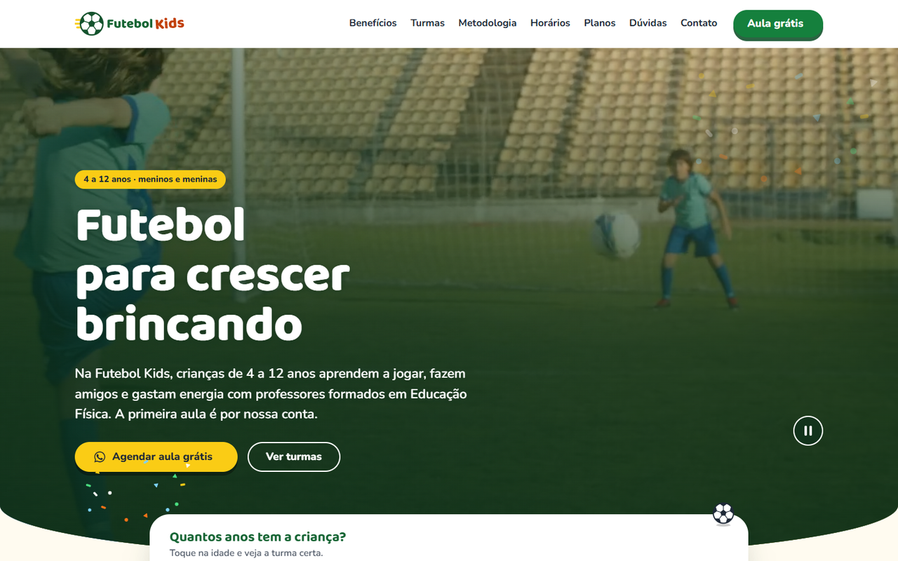
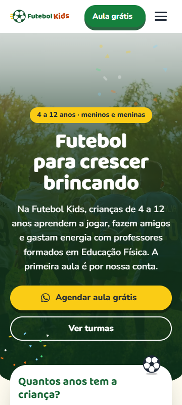

<div align="center">

# ⚽ Futebol Kids

### Escolinha de futebol infantil · 4 a 12 anos

*"Futebol para crescer brincando"*


**[🌐 Ver online](https://sergioribeirosilva.github.io/EsquadraoPixel/futebol-kids/)**

</div>

<table>
  <tr>
    <td width="74%"></td>
    <td width="26%"></td>
  </tr>
  <tr>
    <td align="center"><sub>Desktop · 1280 px</sub></td>
    <td align="center"><sub>Celular · 360 px</sub></td>
  </tr>
</table>

---

## 📌 Sobre

A **Futebol Kids** é uma escolinha de futebol para meninos e meninas de **4 a 12 anos**, do iniciante a quem já joga. A landing page fala com quem decide (pais e responsáveis) sem perder o clima de brincadeira, e tem um objetivo só: **agendar uma aula experimental grátis** pelo WhatsApp.

| | |
|---|---|
| **Pedido original** | "Crie uma página para uma escolinha de futebol infantil para crianças de 4 a 12 anos. O nome é Futebol Kids. Use dados fictícios e ao final pode fazer o push." |
| **Tipo** | Landing page de serviço (escola de esporte) |
| **Público** | Pais e responsáveis de 25 a 50 anos, a maioria no celular |
| **Tom de voz** | Alegre, acolhedor, enérgico e confiável, sem prometer "virar jogador profissional" |
| **CTA principal** | Agendar aula grátis (WhatsApp) |
| **CTA secundário** | Ver turmas e horários |

---

## 🧭 Seções

1. **Hero com vídeo de fundo** em tela cheia (foto vertical no celular) e botão de pausar
2. **Seletor de idade**: *"Quantos anos tem a criança?"* leva direto à turma certa
3. **Benefícios**: coordenação, socialização, autoestima, saúde e valores
4. **Turmas por fase**: Fraldinha (4–5), Pré-mirim (6–7), Mirim (8–9) e Infantil (10–12)
5. **Metodologia**: aprender brincando, turmas reduzidas
6. **Diferenciais**: professores com CREF, grama sintética, portaria, uniforme, relatório para os pais
7. **Grade de horários** por turma
8. **Professores** (exemplos)
9. **Planos** de 1, 2 ou 3 vezes por semana, com desconto para irmãos
10. **Depoimentos de famílias** (exemplos)
11. **Perguntas frequentes**
12. **Localização** com mapa interativo do Google
13. **CTA final** de aula grátis e rodapé

---

## 🎨 Design system

**Conceito: "Dia de jogo no gramado".** Verde-gramado vivo, sol amarelo e céu azul, linhas de campo desenhadas e tipografia redonda e encorpada. Infantil sem ser bobo, e confiável para os pais.

| Cor | Token | Hex | Uso |
|:-:|---|---|---|
|  | `--verde-900` | `#14532D` | Títulos e fundos escuros |
|  | `--verde-700` | `#15803D` | Cor principal, botões |
|  | `--verde-400` | `#4ADE80` | Destaques sobre fundo escuro |
|  | `--amarelo-400` | `#FACC15` | CTA de aula grátis, selos |
|  | `--azul-700` | `#1D4ED8` | Apoio, links |
|  | `--azul-100` | `#E0F2FE` | Fundos de seção (céu) |
|  | `--coral-700` | `#C2410C` | Acento e alertas |

**Tipografia:** [Baloo 2](https://fonts.google.com/specimen/Baloo+2) nos títulos e [Nunito](https://fonts.google.com/specimen/Nunito) no texto (Google Fonts, `display=swap`).

**Recursos de interface:**
- 🎬 Vídeo de fundo no hero, com poster, **botão de pausar** e desligado por `prefers-reduced-motion`
- 🎯 Seletor de idade que destaca a turma certa
- 🗺️ Mapa interativo do Google na seção de localização
- 🍔 Menu mobile acessível, com `Esc` para fechar e o foco devolvido ao botão
- 💬 Links de WhatsApp com mensagens prontas por turma

---

## 📊 Avaliação

**Decisão final: ✅ APROVADO no ciclo 2 de 3**, com média **4,43**.

| Critério | Nota |
|---|:-:|
| Aderência ao briefing | ⭐⭐⭐⭐⭐ 5 |
| Hierarquia e clareza | ⭐⭐⭐⭐⭐ 5 |
| Estética moderna | ⭐⭐⭐⭐ 4 |
| Coerência com o design | ⭐⭐⭐⭐ 4 |
| Qualidade do texto | ⭐⭐⭐⭐⭐ 5 |
| Imagens e assets | ⭐⭐⭐⭐ 4 |
| Experiência mobile | ⭐⭐⭐⭐ 4 |

**Lighthouse (celular, ciclo 2):** desempenho **82–89** (mediana 87) · acessibilidade **100** · boas práticas **100** · SEO **100** · LCP 3,5 s

Relatórios completos: [`inspecao-visual.md`](inspecao-visual.md) · [`avaliacao-tecnica.md`](avaliacao-tecnica.md) · [`avaliacao.md`](avaliacao.md) · [`capturas/`](capturas/)

---

## 🚀 Como abrir

Online: **https://sergioribeirosilva.github.io/EsquadraoPixel/futebol-kids/**

```bash
cd projetos/futebol-kids/site
# duplo clique em index.html, ou:
python -m http.server 8080   # http://localhost:8080
```

A pasta [`site/`](site/) tem todos os assets dentro dela e pode ser publicada sozinha.

---

## 📁 Arquivos do projeto

| Arquivo | Etapa | Conteúdo |
|---|---|---|
| [`briefing.md`](briefing.md) | 0 | Pedido e premissas assumidas |
| [`entrevista.md`](entrevista.md) | 0b | Roteiro de perguntas |
| [`dados-negocio.md`](dados-negocio.md) | 0b | Contatos **fictícios**, links `wa.me`, JSON-LD e mapa |
| [`pesquisa.md`](pesquisa.md) | 1 | Referências com fonte |
| [`design.md`](design.md) | 2 | Design system e escolha do hero |
| [`conteudo.md`](conteudo.md) | 3 | Toda a copy do site |
| [`imagens.md`](imagens.md) | 4 | Créditos e licenças das fotos e do vídeo |
| [`site/`](site/) | 5 | `index.html`, `styles.css`, `script.js`, [`CHANGELOG.md`](site/CHANGELOG.md) |

---

## ⚠️ Pendências antes de publicar

- [ ] **Dados reais**: WhatsApp, e-mail, endereço, horários, preços e coordenadas do mapa (hoje fictícios; o mapa aponta para Brasília). O JSON-LD também usa os dados fictícios.
- [ ] **Fotos e vídeo próprios**, com autorização dos pais: crianças, equipe e depoimentos. Refazer o `og-image.jpg`.
- [ ] **Professores e depoimentos reais**
- [ ] **Vídeo**: se trocar, gerar o MP4 com `+faststart` e conferir no Firefox e no Safari
- [ ] **Domínio**: URL absoluta no `og:image`, `og:url` e `canonical`
- [ ] Conferir os textos de crédito das fotos com o `redator`

---

## 📸 Créditos

As fotos e o vídeo vêm de Unsplash, Pexels e Pixabay (licenças próprias de cada banco, uso livre). Os autores estão em [`imagens.md`](imagens.md) e no rodapé do site. As fotos de crianças, professores e famílias são ilustrativas. Os SVGs, como o logotipo e as linhas de campo, são originais.

<div align="center"><sub>Parte do <a href="../../README.md">Esquadrão Pixel</a></sub></div>
