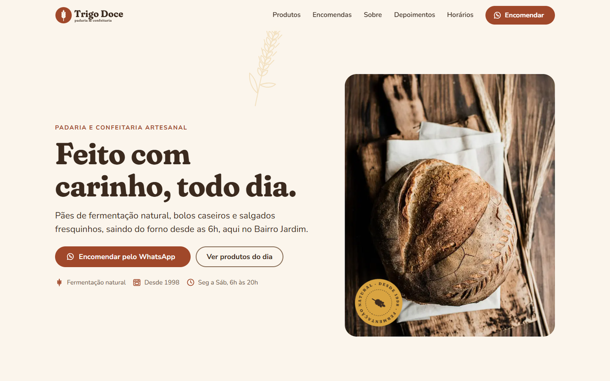
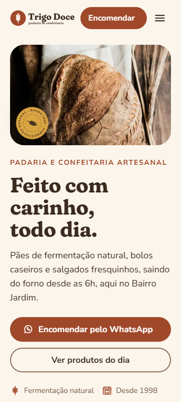

<div align="center">

# 🥖 Padaria Trigo Doce

### Padaria e confeitaria artesanal, com encomendas pelo WhatsApp

*"Feito com carinho, todo dia."*


**[🌐 Ver online](https://sergioribeirosilva.github.io/EsquadraoPixel/padaria-trigo-doce/)**

</div>

<table>
  <tr>
    <td width="74%"></td>
    <td width="26%"></td>
  </tr>
  <tr>
    <td align="center"><sub>Desktop · 1280 px</sub></td>
    <td align="center"><sub>Celular · 360 px</sub></td>
  </tr>
</table>

---

## 📌 Sobre

**Projeto de teste** do fluxo do Esquadrão Pixel. Todos os dados são fictícios e não houve entrevista. É a landing page de uma padaria de bairro, com visual **claro e quente** que lembra o cheirinho de pão saindo do forno. O objetivo é levar o visitante a **encomendar pelo WhatsApp** (bolos, tortas, salgados para festas, cestas de café da manhã) e a visitar a loja.

| | |
|---|---|
| **Público** | Famílias do bairro, de 25 a 60 anos, e quem organiza aniversários e cafés da manhã |
| **Tom de voz** | Acolhedor, afetivo, caseiro e apetitoso |
| **CTA principal** | Encomendar pelo WhatsApp |
| **CTA secundário** | Ver produtos do dia |

---

## 🧭 Seções

1. **Hero** com selo "Forno a lenha · Fermentação natural" e informações rápidas
2. **Destaques do dia**: pães, doces, bolos e salgados com preços de exemplo
3. **Encomendas para festas**, com o passo a passo de como encomendar
4. **Sobre**: "Uma receita de família desde 1998"
5. **Equipe**: "Mãos que fazem a Trigo Doce"
6. **Depoimentos**: "O que dizem os vizinhos" (exemplos)
7. **Horários e endereço**, com link de mapa genérico (sem iframe, porque o endereço é fictício)
8. **CTA final**: "Bateu vontade? A gente prepara para você."
9. **Rodapé** com aviso de site de demonstração

---

## 🎨 Design system

**Conceito:** padaria artesanal com afeto. Fundo creme, tons de casca de pão e café, terracota nos CTAs e mel nos detalhes.

| Cor | Token | Hex | Uso |
|:-:|---|---|---|
|  | `--cor-creme` | `#FBF5EC` | Fundo |
|  | `--cor-cafe` | `#3B2A1E` | Texto e títulos |
|  | `--cor-marrom` | `#6B4F3A` | Texto de apoio |
|  | `--cor-terracota` | `#A0482A` | CTAs |
|  | `--cor-mel` | `#D9A441` | Selo e detalhes |

**Tipografia:** [Fraunces](https://fonts.google.com/specimen/Fraunces) nos títulos, com personalidade artesanal, e [Nunito Sans](https://fonts.google.com/specimen/Nunito+Sans) no texto.

---

## 📊 Avaliação

O projeto começou como protótipo de teste, antes de existirem o `redator` e o `entrevistador` (por isso não tem `conteudo.md` nem `dados-negocio.md`). Em 18/11/2026 ele passou pelas etapas 6 a 8.

**Decisão final: ✅ APROVADO no ciclo 2 de 3**, com média **4,57** (no ciclo 1 foi 4,0, com ITERAR).

| Critério | Nota |
|---|:-:|
| Aderência ao briefing | ⭐⭐⭐⭐⭐ 5 |
| Hierarquia e clareza | ⭐⭐⭐⭐⭐ 5 |
| Estética moderna | ⭐⭐⭐⭐ 4 |
| Coerência com o design | ⭐⭐⭐⭐⭐ 5 |
| Qualidade do texto | ⭐⭐⭐⭐⭐ 5 |
| Imagens e assets | ⭐⭐⭐⭐ 4 |
| Experiência mobile | ⭐⭐⭐⭐ 4 |

**O que mudou no ciclo 2:** o selo do hero dá uma volta só e para (WCAG 2.2.2); o hero mostra o título e o botão na primeira tela no tablet e no celular; a foto do hero ganhou versões WebP de 480 e 640 px e as fontes deixaram de bloquear a renderização; os depoimentos ganharam uma citação em destaque; o selo passou a dizer "Desde 1998".

**Lighthouse (celular, ciclo 2):** desempenho **79–97** · acessibilidade **100** · boas práticas **100** · SEO **100** · LCP mediana 2,4 s

Relatórios completos: [`inspecao-visual.md`](inspecao-visual.md) · [`avaliacao-tecnica.md`](avaliacao-tecnica.md) · [`avaliacao.md`](avaliacao.md) · [`capturas/`](capturas/)

---

## 🚀 Como abrir

Online: **https://sergioribeirosilva.github.io/EsquadraoPixel/padaria-trigo-doce/**

```bash
cd projetos/padaria-trigo-doce/site
# duplo clique em index.html, ou:
python -m http.server 8080   # http://localhost:8080
```

A pasta [`site/`](site/) tem todos os assets dentro dela e pode ser publicada sozinha.

---

## 📁 Arquivos do projeto

| Arquivo | Etapa | Conteúdo |
|---|---|---|
| [`briefing.md`](briefing.md) | 0 | Pedido e premissas (todos os dados fictícios) |
| [`pesquisa.md`](pesquisa.md) | 1 | Referências |
| [`design.md`](design.md) | 2 | Design system |
| [`imagens.md`](imagens.md) | 4 | Créditos e licenças |
| [`site/`](site/) | 5 | `index.html`, `styles.css`, `script.js`, [`CHANGELOG.md`](site/CHANGELOG.md), `assets/` |
| [`fontes-svg/`](fontes-svg/) | — | SVGs-fonte que o site não carrega (guardados fora de `site/`) |
| [`inspecao-visual.md`](inspecao-visual.md) | 6 | Inspeção no navegador, ciclos 1 e 2 |
| [`avaliacao-tecnica.md`](avaliacao-tecnica.md) | 7 | Avaliação técnica, ciclos 1 e 2 |
| [`avaliacao.md`](avaliacao.md) | 8 | Decisão: ITERAR no ciclo 1, APROVADO no ciclo 2 |

---

## ⚠️ Para virar um site real

- [ ] *(desempenho)* Hospedar as fontes localmente (woff2 com `preload`) e usar `content-visibility` nas seções abaixo da dobra, para baixar o TBT de 160–450 ms
- [ ] *(menores)* Ponta do ramo de trigo atrás do cabeçalho no desktop; link "Sobre" do rodapé com 40 px de largura; `srcset` de 400w nos cards; SVGO nos logos
- [ ] Trocar os dados fictícios: Rua das Flores, 250; WhatsApp `(00) 90000-0000`; Instagram e horários
- [ ] Coordenadas reais, para o mapa interativo
- [ ] Fotos reais dos produtos, da loja e da equipe
- [ ] Preços e depoimentos reais, e tirar o aviso de demonstração
- [ ] JSON-LD (`Bakery`) e domínio

---

## 📸 Créditos

As fotos vêm de Unsplash e Wikimedia Commons e são ilustrativas. Os SVGs são originais. Os detalhes estão em [`imagens.md`](imagens.md).

<div align="center"><sub>Parte do <a href="../../README.md">Esquadrão Pixel</a></sub></div>
