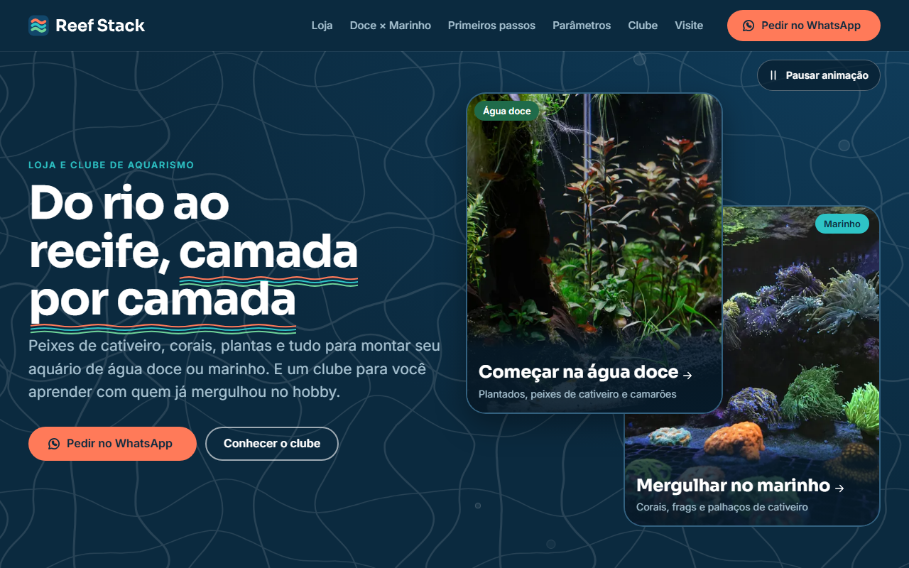
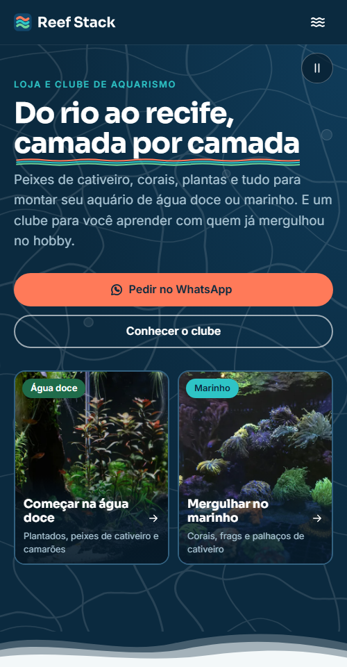

<div align="center">

# 🐠 Reef Stack

### Loja e clube de aquarismo · água doce e marinho

*"Do rio ao recife, camada por camada"*


</div>

<table>
  <tr>
    <td width="74%"></td>
    <td width="26%"></td>
  </tr>
  <tr>
    <td align="center"><sub>Desktop · 1280 px</sub></td>
    <td align="center"><sub>Celular</sub></td>
  </tr>
</table>

---

## 📌 Sobre

A **Reef Stack** é uma loja de aquarismo com um clube de aquaristas, e atende os dois mundos: **água doce** (plantados, peixes de cativeiro, camarões) e **marinho** (corais, frags, peixes de recife de cativeiro). A landing page faz três coisas:

- **converte**: o CTA principal leva a um pedido ou orçamento pelo WhatsApp;
- **forma comunidade**: convida para o clube, com encontros, oficinas e troca de mudas e frags;
- **educa**: um guia para iniciantes mostra a autoridade da loja (comparativo, ciclagem, parâmetros).

| | |
|---|---|
| **Pedido original** | "Desenvolver um site sobre aquarismo, água doce e marinho" |
| **Tipo** | Loja + clube/comunidade |
| **Público** | Iniciantes e entusiastas de 18 a 55 anos, a maioria no celular |
| **Tom de voz** | Didático, entusiasmado e confiável |
| **CTA principal** | Pedir no WhatsApp |
| **CTA secundário** | Conhecer o clube |

---

## 🧭 Seções

1. **Hero** com dois cartões-caminho: *Começar na água doce* e *Mergulhar no marinho*
2. **Loja**: tudo para o aquário, do primeiro peixe ao primeiro coral
3. **Água doce × Marinho**: comparativo, mais espécies para iniciantes em abas
4. **Primeiros passos**: montagem e diagrama do ciclo do nitrogênio
5. **Parâmetros da água**: tabela de referência em abas (doce e marinho)
6. **Clube Reef Stack**: benefícios, encontros, oficinas e formulário que abre o WhatsApp
7. **Bem-estar animal e procedência legal**
8. **Depoimentos** (exemplos)
9. **Perguntas frequentes**, com os erros comuns de iniciante
10. **Visite a loja**: endereço, horários e mapa ilustrativo em SVG
11. **Rodapé** com redes e créditos das fotos

---

## 🎨 Design system

**Conceito: "Camadas de água".** O logo são três faixas onduladas empilhadas: verde para a água doce, turquesa e coral para o recife. As mesmas camadas aparecem nos divisores de seção e na sombra em pilha dos cartões.

| Cor | Token | Hex | Uso |
|:-:|---|---|---|
|  | `--abismo-950` | `#071C2C` | Fundo mais profundo |
|  | `--abismo-900` | `#0B2A3F` | Fundo base (branco sobre ele: ~14,8:1) |
|  | `--oceano-700` | `#12476B` | Superfícies marinhas |
|  | `--lagoa-400` | `#2EC4C6` | Destaques e anel de foco |
|  | `--musgo-600` | `#1F6B4A` | Identidade da água doce |
|  | `--coral-400` | `#FF7A59` | CTA sobre fundo escuro, com texto escuro (~5,7:1) |
|  | coral escuro | `#B8432A` | CTA sobre fundo claro, com texto branco (~5,4:1) |

**Tipografia:** [Sora](https://fonts.google.com/specimen/Sora) nos títulos e [Inter](https://fonts.google.com/specimen/Inter) no texto. As duas são **hospedadas no próprio site** (woff2 variável, subset latin, `preload`), com licença SIL OFL.

**Recursos de interface:**
- 🫧 Bolhas e reflexos de luz animados, com **botão de pausa** (preferência salva) e desligados por `prefers-reduced-motion`
- 🗂️ Abas **WAI-ARIA** acessíveis e sincronizadas entre espécies e parâmetros, com navegação por setas e hash na URL
- 📱 Tabelas que viram cartões empilhados abaixo de 600 px
- 🍔 Menu mobile em tela cheia, com `inert` no conteúdo, `Esc` para fechar e o foco devolvido ao botão
- 💬 Links de WhatsApp montados a partir de uma única constante, com 5 mensagens prontas

---

## 📊 Avaliação

**Decisão final: ✅ APROVADO no ciclo 2 de 3**, com média **4,71** (no ciclo 1 era 4,14).

| Critério | Nota |
|---|:-:|
| Aderência ao briefing | ⭐⭐⭐⭐⭐ 5 |
| Hierarquia e clareza | ⭐⭐⭐⭐⭐ 5 |
| Estética moderna | ⭐⭐⭐⭐⭐ 5 |
| Coerência com o design | ⭐⭐⭐⭐⭐ 5 |
| Qualidade do texto | ⭐⭐⭐⭐ 4 |
| Imagens e assets | ⭐⭐⭐⭐⭐ 5 |
| Experiência mobile | ⭐⭐⭐⭐ 4 |

**Lighthouse (celular, ciclo 2):** desempenho **86–88** · acessibilidade **100** · boas práticas **100** · SEO **100** · LCP 3,1 s

Relatórios completos: [`inspecao-visual.md`](inspecao-visual.md) · [`avaliacao-tecnica.md`](avaliacao-tecnica.md) · [`avaliacao.md`](avaliacao.md) · [`capturas/`](capturas/)

---

## 🚀 Como abrir

```bash
cd projetos/reef-stack/site
# duplo clique em index.html, ou:
python -m http.server 8080   # http://localhost:8080
```

A pasta [`site/`](site/) tem todos os assets e as fontes dentro dela e pode ser publicada sozinha.

---

## 📁 Arquivos do projeto

| Arquivo | Etapa | Conteúdo |
|---|---|---|
| [`briefing.md`](briefing.md) | 0 | Pedido, premissas e respostas do usuário |
| [`entrevista.md`](entrevista.md) | 0b | Roteiro de perguntas e respostas |
| [`dados-negocio.md`](dados-negocio.md) | 0b | Contatos **fictícios** e links `wa.me` |
| [`pesquisa.md`](pesquisa.md) | 1 | Conteúdo técnico com fonte, legislação, referências |
| [`design.md`](design.md) | 2 | Design system completo |
| [`conteudo.md`](conteudo.md) | 3 | Toda a copy do site |
| [`imagens.md`](imagens.md) | 4 | Créditos e licenças das fotos |
| [`site/`](site/) | 5 | `index.html`, `styles.css`, `script.js`, [`CHANGELOG.md`](site/CHANGELOG.md) |

---

## ⚠️ Pendências antes de publicar

- [ ] **Dados reais**: WhatsApp, telefone, e-mail, endereço, horários e redes (hoje fictícios, com o domínio reservado `.example`)
- [ ] **Loja**: preços "a partir de"; se fazem quarentena, teste de água com amostra e entrega, e em qual área
- [ ] **Clube**: mensalidade e datas reais dos encontros
- [ ] **Parâmetros do marinho**: valores de pH e nitrato definidos por um aquarista de confiança
- [ ] **Fotos reais** da loja, da vitrine, do clube e dos depoimentos, e depoimentos reais autorizados
- [ ] **Endereço real**: mapa interativo e JSON-LD
- [ ] **Domínio**: substituir `https://SEU-DOMINIO/` (`canonical`, `og:url`, `og:image`)
- [ ] *(recomendado)* Gerar o preload das fontes só quando o site for servido por http, e fazer `preload` de `causticas.svg` para baixar o LCP

---

## 📸 Créditos

As fotos vêm de Unsplash, Pexels e Wikimedia Commons (CC0, CC BY 3.0, CC BY 4.0 e domínio público). Os autores e as licenças estão em [`imagens.md`](imagens.md) e no rodapé do site. As fotos de pessoas, da loja e do clube são ilustrativas. Os SVGs são originais.

<div align="center"><sub>Parte do <a href="../../README.md">Esquadrão Pixel</a></sub></div>
