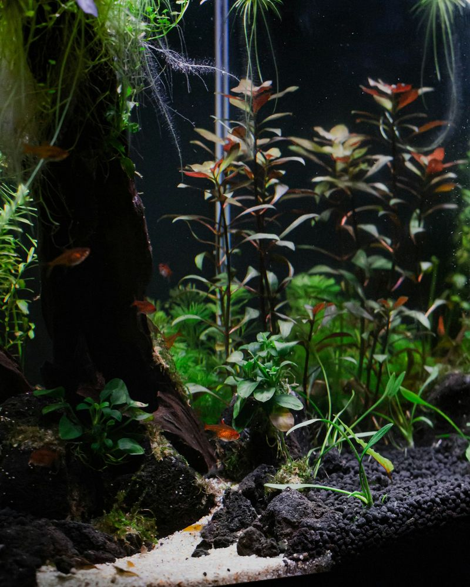

# Imagens e assets: Reef Stack

> Autor: gerador-imagens · 2026-11-16 · Entradas: `design.md` (§8 Pedidos de imagem, tokens §2.1), `briefing.md`, `pesquisa.md` (§3 e Riscos).
> **Onde estão:** cópia de trabalho em `projetos/reef-stack/assets/` e **cópia final idêntica em `site/assets/`** (o site só deve referenciar `site/assets/`, com caminhos relativos `assets/...`). Os nomes seguem a tabela do `design.md` §8, sem subpastas. O único acréscimo é o sufixo de largura nas fotos (`-480`, `-800` etc.).
> Data do download de todas as fotos: **2026-11-16**. As fotos foram exportadas em **WebP (q78) + JPG progressivo (q80)**, sem EXIF, nas duas larguras pedidas para `srcset`. Cores dos SVGs: só a paleta do `design.md`.

## 1. Fotos

Licenças aceitas pela regra do projeto: Unsplash License, Pexels License, CC0, domínio público, CC BY 2.0/3.0/4.0. **Nenhuma foto CC BY-SA foi usada.**

| Arquivo(s) em `assets/` | Uso | Saída (dimensões · peso WebP / JPG) | Página da foto | Autor | Banco · licença | Original | `alt` sugerido | Status |
|---|---|---|---|---|---|---|---|---|
| `foto-caminho-doce-480` / `-800` (.webp/.jpg) | Cartão-caminho "Água doce" (hero), 4:5 | 480x600 · 46 / 61 KB; 800x1000 · 91 / 138 KB | https://unsplash.com/photos/a-fish-tank-filled-with-plants-and-water-xtbZ1jnpuEY | Christian Ang | Unsplash · Unsplash License | 2856x3865 | "Aquário plantado com troncos, plantas verdes e avermelhadas e pequenos peixes" | Pronto |
| `foto-caminho-marinho-480` / `-800` | Cartão-caminho "Marinho" (hero), 4:5 | 480x600 · 47 / 61 KB; 800x1000 · 97 / 140 KB | https://unsplash.com/photos/colorful-corals-in-saltwater-aquarium-xCz7oblY3Qk | Friska Venunza Bayu | Unsplash · Unsplash License | 3024x4032 | "Aquário marinho com corais coloridos sob luz azul e frags num suporte" | Pronto |
| `foto-loja-ambiente-640` / `-1200` | Faixa de CTA da loja, 16:10 | 640x400 · 36 / 49 KB; 1200x750 · 90 / 143 KB | https://www.pexels.com/photo/a-woman-by-an-aquarium-15731660/ | Yi Ren | Pexels · Pexels License | 6720x4480 | "Cliente observa peixes nos aquários iluminados de uma loja de aquarismo (foto ilustrativa)" | Pronto · **substituir antes de publicar** (ideal: foto real do interior da Reef Stack) |
| `foto-clube-encontro-640` / `-1100` | Clube, 4:3 | 640x480 · 39 / 57 KB; 1100x825 · 88 / 138 KB | https://commons.wikimedia.org/wiki/File:Aquascaping_Team_Planting_Aquarium_Hardscape.jpg | Abhik.Mazumdar.73 | Wikimedia Commons · **CC BY 4.0** | 4191x2784 | "Grupo de aquaristas monta um aquário com troncos e plantas numa oficina (foto ilustrativa)" | Pronto · **substituir antes de publicar** (foto real de um encontro do clube, com autorização) · **crédito obrigatório** |
| `foto-vitrine-640` / `-1000` (opcional) | Visite a loja, 16:10 | 640x400 · 36 / 49 KB; 1000x625 · 70 / 104 KB | https://unsplash.com/photos/a-fish-tank-filled-with-plants-and-rocks--gxn0RkXsG0 | Christian Ang | Unsplash · Unsplash License | 5086x3391 | "Aquário plantado comprido, com pedras, plantas e peixes pequenos" | Pronto · opcional · **substituir antes de publicar** (vitrine real da loja) |
| `especie-neon-480` / `-720` | Espécies doce, 4:3 | 480x360 · 11 / 19 KB; 720x540 · 19 / 34 KB | https://commons.wikimedia.org/wiki/File:Neonsalmler_Paracheirodon_innesi.jpg | Holger Krisp | Wikimedia Commons · **CC BY 3.0** | 3000x1987 | "Tetra-neon, peixe pequeno com faixa azul brilhante e faixa vermelha" | Pronto · **crédito obrigatório** |
| `especie-guppy-480` / `-720` | Espécies doce, 4:3 | 480x360 · 7 / 13 KB; 720x540 · 12 / 26 KB | https://unsplash.com/photos/a-group-of-fish-swimming-in-an-aquarium-LEw6N9wLQQE | Diogo Cardoso | Unsplash · Unsplash License | 6000x4000 | "Guppies machos de cauda colorida nadando num aquário" | Pronto |
| `especie-betta-480` / `-720` | Espécies doce, 4:3 | 480x360 · 16 / 26 KB; 720x540 · 26 / 47 KB | https://unsplash.com/photos/a-bright-red-betta-fish-swims-in-a-blue-aquarium-GQG-cBPcmGs | Likhith Raj | Unsplash · Unsplash License | 4096x3072 | "Betta macho vermelho de nadadeiras longas num aquário plantado" | Pronto |
| `especie-neocaridina-480` / `-720` | Espécies doce, 4:3 | 480x360 · 11 / 19 KB; 720x540 · 19 / 35 KB | https://unsplash.com/photos/a-couple-of-yellow-shrimp-are-in-the-water-vfbrDfUwEDk | Yash Gupta | Unsplash · Unsplash License | 4800x3200 | "Dois camarões Neocaridina amarelos sobre o substrato escuro do aquário" | Pronto (ver obs. 3) |
| `especie-palhaco-480` / `-720` | Espécies marinho, 4:3 | 480x360 · 39 / 44 KB; 720x540 · 70 / 85 KB | https://commons.wikimedia.org/wiki/File:Amphiprion_ocellaris_2.jpg | Karelj | Wikimedia Commons · **domínio público** | 2500x1458 | "Peixe-palhaço sobre um coral mole num aquário" | Pronto |
| `especie-grama-480` / `-720` | Espécies marinho, 4:3 | 480x360 · 51 / 52 KB; 720x540 · 106 / 110 KB | https://commons.wikimedia.org/wiki/File:Monaco.Mus%C3%A9e_oc%C3%A9anographique031.jpg | Georges Jansoone (JoJan) | Wikimedia Commons · **CC BY 3.0** | 1712x1296 | "Grama-real, peixe roxo na frente e amarelo atrás, entre rochas de aquário" | Pronto · **crédito obrigatório** |
| `especie-gobi-480` / `-720` | Espécies marinho, 4:3 | 480x360 · 12 / 22 KB; 720x540 · 21 / 43 KB | https://commons.wikimedia.org/wiki/File:Nemateleotris_magnifica_Prague_2011_1.jpg | Karelj | Wikimedia Commons · **CC0** | 2400x1699 | "Firefish (peixe-fogo), branco com a cauda vermelha, num aquário" | Pronto |
| `especie-coral-mole-480` / `-720` | Espécies marinho (frags), 4:3 | 480x360 · 25 / 34 KB; 720x540 · 44 / 65 KB | https://unsplash.com/photos/colorful-corals-in-saltwater-aquarium-qAAiGzAwSKc | CHAD WINDHEIM | Unsplash · Unsplash License | 3456x2913 | "Corais coloridos crescendo sobre rocha escura num aquário marinho" | Pronto |
| `depoimento-1` (.webp/.jpg) | Depoimento 1 (exemplo), 1:1 | 112x112 · 2 / 3 KB | https://unsplash.com/photos/smiling-woman-at-wooden-table-Ll9YOG20UFI | Nolan Manning | Unsplash · Unsplash License | 2832x3540 | "Foto ilustrativa de cliente" | Pronto · **substituir antes de publicar** (cliente real, com autorização) |
| `depoimento-2` | Depoimento 2 (exemplo), 1:1 | 112x112 · 1 / 3 KB | https://unsplash.com/photos/man-taking-selfie-7azlwCjw7Zg | Gift Habeshaw | Unsplash · Unsplash License | 3840x5760 | "Foto ilustrativa de cliente" | Pronto · **substituir antes de publicar** |
| `depoimento-3` | Depoimento 3 (exemplo), 1:1 | 112x112 · 2 / 3 KB | https://unsplash.com/photos/elderly-man-with-glasses-smiling-at-the-camera-oZ3zejPLEg8 | Vitaly Gariev | Unsplash · Unsplash License | 3840x2160 | "Foto ilustrativa de cliente" | Pronto · **substituir antes de publicar** |
| `og-image.jpg` | Open Graph (1200x630) | 1200x630 · 70 KB | Montagem própria com `logo.svg`, `onda-sublinhado.svg` e as duas fotos dos cartões-caminho | Esquadrão Pixel (fotos: Christian Ang e Friska Venunza Bayu, Unsplash) | Arte própria + Unsplash License | — | — | Pronto |

### 1.1 Créditos para o rodapé (`<details>` "Créditos das fotos")
Os créditos **obrigatórios** são os das fotos CC BY. As fotos do Unsplash e do Pexels e as de CC0 ou domínio público dispensam crédito, mas o design pede que todas sejam creditadas, então o texto abaixo já inclui todas.

**CC BY (obrigatórios; indicar a modificação):**
- Tetra-neon: "Neonsalmler Paracheirodon innesi", de Holger Krisp, CC BY 3.0 (https://creativecommons.org/licenses/by/3.0/), via Wikimedia Commons. Recortada e redimensionada.
- Grama-real: "Monaco.Musée océanographique031", de Georges Jansoone (JoJan), CC BY 3.0 (https://creativecommons.org/licenses/by/3.0/), via Wikimedia Commons. Recortada e redimensionada.
- Encontro do clube: "Aquascaping Team Planting Aquarium Hardscape", de Abhik.Mazumdar.73, CC BY 4.0 (https://creativecommons.org/licenses/by/4.0/), via Wikimedia Commons. Recortada e redimensionada.

**Demais (cortesia):**
- Peixe-palhaço: Karelj, domínio público, Wikimedia Commons. Firefish: Karelj, CC0, Wikimedia Commons.
- Unsplash: Christian Ang (aquário plantado e vitrine), Friska Venunza Bayu (aquário marinho), Diogo Cardoso (guppies), Likhith Raj (betta), Yash Gupta (camarões), CHAD WINDHEIM (corais), Nolan Manning, Gift Habeshaw e Vitaly Gariev (retratos ilustrativos).
- Pexels: Yi Ren (loja).

### 1.2 Observações sobre as fotos
1. **"Nature Aquarium Aquascape.jpg" (Commons, CC0): REJEITADA, provável imagem gerada por IA ou muito ampliada.** Os indícios: (a) 5376x3072 é exatamente 3 vezes 1792x1024, um tamanho padrão de saída de gerador de imagens; (b) não tem nenhum EXIF de câmera; (c) o arquivo pesa só 354 KB para 16,5 MP, o que indica uma imagem pequena ampliada; (d) no recorte em 100%, as folhas e a cascata estão borradas e "pintadas", sem detalhe real; (e) foi enviada em 08/2026 por uma conta nova, com link comercial na descrição. No lugar dela entrou a foto de Christian Ang (Unsplash).
2. **Aquário, não mar:** palhaço, grama-real e firefish são de **aquários públicos**, conforme a descrição de cada arquivo (Prague Sea World e Musée Océanographique de Monaco). As fotos marinhas do Unsplash estão descritas como "saltwater aquarium" e mostram vidro, suporte de frags e rocha de aquário. Nenhuma foto mostra cirurgião-patela ou peixe-leão como espécie de iniciante. A foto do palhaço mostra-o sobre um *Sarcophyton* (coral mole), não sobre anêmona.
3. **Neocaridina:** a foto livre de melhor qualidade é da **variedade amarela** (*Neocaridina davidi* "yellow"), não da red cherry. As red cherry livres do Commons (CC BY 4.0, Uccio D'Agostino) são translúcidas e de baixo contraste. **O redator não deve escrever "red cherry" na legenda desta foto**; prefira "camarão Neocaridina".
4. **Betta:** é um aquário plantado com tetras-neon ao fundo, não um copo nem um pote, o que combina com a mensagem de bem-estar. O aviso "um macho por aquário" continua válido.
5. **Loja e vitrine:** não são da Reef Stack. A da loja mostra uma cliente identificável num pet shop (Pexels, sem marca visível) e a da vitrine é um aquário plantado de exposição. As duas estão marcadas como **substituir antes de publicar**.
6. **Encontro do clube:** são aquaristas montando um aquário juntos, o que combina com "oficinas práticas". Os rostos são identificáveis e a foto é ilustrativa. Use `alt` com "(foto ilustrativa)" e marque **substituir antes de publicar**.
7. **Depoimentos:** são retratos variados (mulher jovem, homem jovem e homem idoso) com o rosto visível. São pessoas reais em depoimentos inventados, então use **`alt="Foto ilustrativa de cliente"`**, mantenha o selo/nota "Depoimentos ilustrativos" e deixe-os como **substituir antes de publicar**.
8. **Enquadramento:** todas as fotos já estão recortadas na proporção final, então `object-position: 50% 50%` funciona. No cartão "Água doce", a areia clara fica no rodapé da foto, debaixo do degradê da legenda (o degradê cobre os 55% inferiores e garante o contraste). Se o cartão "Marinho" ficar mais baixo que 4:5, use `object-position: 50% 70%` para manter os frags visíveis.

### 1.3 Uso sugerido no HTML (exemplo, sem copy)
```html
<picture>
  <source type="image/webp" srcset="assets/foto-caminho-doce-480.webp 480w, assets/foto-caminho-doce-800.webp 800w" sizes="(min-width: 900px) 360px, 45vw">
  
</picture>
```

## 2. SVGs (arte original do time)

Todos são **XML válido** (conferido com parser, 45 arquivos, 42 KB no total). Nenhum tem script, fonte externa ou base64. Os ícones seguem o padrão do design: `viewBox="0 0 24 24"`, traço de 2 px, pontas arredondadas, `stroke="currentColor"`, `aria-hidden="true"` e `focusable="false"`, com 0,2 a 0,8 KB cada.

| Arquivo | Uso | Acessibilidade | Tamanho | Status |
|---|---|---|---|---|
| `logo.svg` | Cabeçalho e rodapé (fundo escuro). Símbolo de 3 faixas onduladas (verde, turquesa e coral, de baixo para cima) num quadrado `#12476B`, mais "Reef Stack" em Sora 700 **convertido em contornos** (fonte OFL) e branco | Tem `<title>`. No link, use `aria-label="Reef Stack, início"` e `alt=""` na imagem, ou `alt="Reef Stack"` | 4,9 KB | Pronto |
| `logo-escuro.svg` | Fundos claros: faixas `#1F6B4A`/`#0A6E78`/`#B8432A`, texto `#0B2A3F`, quadrado branco com borda `#C9D9E1` | Idem | 5,0 KB | Pronto |
| `logo-simbolo.svg` | Só o símbolo (32x32), para usos compactos | Decorativo | 0,4 KB | Pronto (extra) |
| `favicon.svg`, `favicon-32.png`, `apple-touch-icon.png` (180x180, opaco) | Ícones da aba e do iOS | n/a | 0,4 / 1,3 / 8 KB | Pronto |
| `divisor-camadas.svg` | Divisores claro ↔ escuro. 3 ondas com `currentColor` (opacidades .25 / .55 / 1), `preserveAspectRatio="none"`, viewBox 1440x80 | `aria-hidden`. **Inserir inline** para herdar `color` | 0,4 KB | Pronto |
| `causticas.svg` | Fundo do hero e do clube (`::before`, `background-size: 600px`). Malha orgânica branca de traço 1,5 a 3 px, **repetível sem emenda** (curvas periódicas de 600 px) | Decorativo | 9,0 KB | Pronto |
| `onda-sublinhado.svg` | Sublinhado da palavra-chave do H1. 3 traços (coral, turquesa e verde) com `preserveAspectRatio="none"` e `vector-effect="non-scaling-stroke"`, que estica sem engrossar | `aria-hidden` | 0,6 KB | Pronto |
| `ciclo-nitrogenio.svg` (640x260) e `ciclo-nitrogenio-vertical.svg` (320x520) | Passo 4 (ciclagem), via `<picture>` com `media="(min-width: 600px)"` | `role="img"` + `<title>`/`<desc>` em português. No ``, repita no `alt`: "Ciclo do nitrogênio: restos de comida e excrementos viram amônia, bactérias a transformam em nitrito e depois em nitrato, que é reduzido pelas trocas parciais de água e pelas plantas." | 3,2 / 2,4 KB | Pronto |
| `mapa-ilustrativo.svg` (700x440) | Visite a loja. Quarteirões abstratos, rio, praça e pino `#B8432A` com o símbolo. Rótulo "Mapa ilustrativo" | `role="img"` + `<title>`. `alt="Mapa ilustrativo, sem localização real"` | 3,4 KB | Pronto |
| Ícones de categoria: `icone-peixe`, `icone-coral`, `icone-planta`, `icone-camarao`, `icone-equipamento` (aquecedor), `icone-racao-teste`, `icone-montagem` | Na loja | Decorativos | ≤ 0,7 KB | Pronto |
| Ícones do clube: `icone-encontro`, `icone-oficina` (mão + pinça de aquapaisagismo), `icone-troca`, `icone-grupo` | Clube | Decorativos | ≤ 0,6 KB | Pronto |
| Ícones de compromisso: `icone-cativeiro`, `icone-procedencia`, `icone-orientacao`, `icone-nao-soltar` | Compromisso | Decorativos | ≤ 0,7 KB | Pronto |
| Abas: `icone-folha`, `icone-coral-mini`, `icone-check` | Alternador doce × marinho | Decorativos | ≤ 0,4 KB | Pronto |
| Utilitários: `icone-whatsapp`, `icone-instagram`, `icone-youtube`, `icone-facebook`, `icone-telefone`, `icone-email`, `icone-pino`, `icone-relogio`, `icone-info`, `icone-alerta`, `icone-chevron`, `icone-seta`, `icone-pausa`, `icone-play`, `icone-menu`, `icone-fechar`, `aspas` | Diversos | Decorativos. O botão ou link que só tem ícone leva `aria-label` | ≤ 0,6 KB | Pronto |

### 2.1 Notas para o desenvolvedor
- **Logo:** o viewBox ficou em **186x40** (e não 220x40) para não sobrar espaço vazio à direita do texto. Use `height: 32px` / `36px` e `width: auto`.
- **`icone-menu.svg`:** as três faixas onduladas têm as classes `faixa faixa-1`, `faixa-2` e `faixa-3`. Inserido inline, permite a animação para "X" pedida no §5.2.
- **Ícones com `currentColor`:** só herdam a cor quando estão **inline** (ou via `mask-image`). Num ``, aparecem pretos.
- **Marcas** (WhatsApp, Instagram, YouTube, Facebook): são versões monocromáticas simplificadas em traço, sem cores nem logotipos oficiais completos.
- **Textos dos SVGs do ciclo e do mapa:** são `<text>` reais com `font-family="Inter, 'Segoe UI', Arial, sans-serif"`. Dentro de `` o SVG não carrega o Google Fonts, então aparece a Segoe UI ou a Arial, com a mesma legibilidade. Para usar a Inter, insira inline. O corpo de texto tem 15 px no viewBox, então mantenha o ciclo horizontal com pelo menos ~560 px de largura para os rótulos ficarem com 14 px ou mais na tela.
- **Ciclo:** não diz que o nitrato zera ("trocas parciais de água e plantas reduzem o nitrato"; legenda: "menos tóxico, mas se acumula").
- **Alternativa em SVG para peixes sem foto:** não foi necessária, porque foram achadas fotos livres de grama-real, firefish e encontro do clube.

## 3. Lacunas
Nenhuma. `assets/prompts-imagens.md` não foi criado. Para publicar, ainda faltam as **fotos próprias** da loja (interior e vitrine), de um encontro real do clube e dos clientes dos depoimentos. Todas estão marcadas como "substituir antes de publicar".
