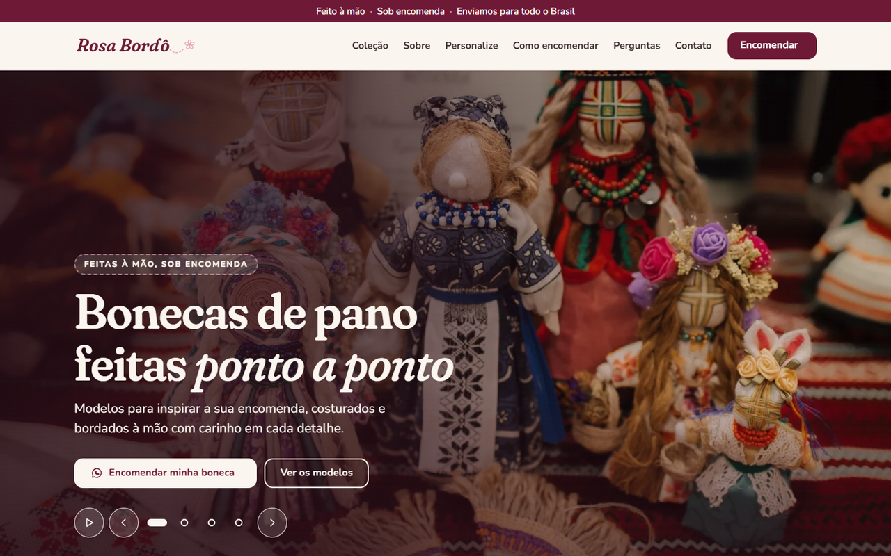
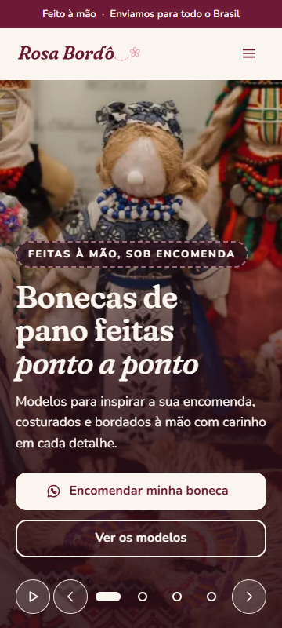

<div align="center">

# 🪡 Rosa Bordô

### Bonecas de pano feitas à mão · sob encomenda

*"Bonecas de pano feitas ponto a ponto"*


**[🌐 Ver online](https://sergioribeirosilva.github.io/EsquadraoPixel/rosa-bordo/)**

</div>

<table>
  <tr>
    <td width="74%"></td>
    <td width="26%"></td>
  </tr>
  <tr>
    <td align="center"><sub>Desktop · 1280 px</sub></td>
    <td align="center"><sub>Celular · 360 px</sub></td>
  </tr>
</table>

---

## 📌 Sobre

A **Rosa Bordô** ([@arosabordo](https://www.instagram.com/arosabordo/)) é o ateliê de uma artesã que costura e borda bonecas de pano à mão, sob encomenda. O site apresenta os modelos, mostra o cuidado do feito à mão e leva a visitante a **encomendar a boneca** pelo WhatsApp.

O Instagram exige login, então só foi possível ler o título público do perfil. A bio, as fotos e os contatos não foram acessados: os textos e as fotos são de exemplo até chegarem os reais.

| | |
|---|---|
| **Pedido original** | "Acesse o perfil arosabordo no Instagram. Pertence à minha esposa, que é artesã e confecciona bonecas de pano. No hero coloque um grande carrossel com ao menos 3 imagens. Use dados fictícios por enquanto." |
| **Tipo** | Landing page de ateliê / encomendas |
| **Público** | Mães, avós, tias e madrinhas de 25 a 60 anos, vindas do Instagram e no celular |
| **Tom de voz** | Afetivo, artesanal e próximo, na primeira pessoa |
| **CTA principal** | Encomendar minha boneca (WhatsApp) |
| **CTA secundário** | Seguir no Instagram |

---

## 🧭 Seções

1. **Hero com carrossel grande** em tela cheia: 4 slides de foto, setas, indicadores e botão de pausar *(pedido do usuário)*
2. **Faixa de diferenciais**: costurada à mão, rostinho bordado, personalização, envio para todo o Brasil
3. **Coleção**: 6 modelos de exemplo, com tamanho e preço "a partir de"
4. **Sobre a artesã**: história, processo e materiais
5. **Personalize**: *"Monte a boneca de quem você ama"* (pele, cabelo, roupinha, nome bordado)
6. **Como encomendar**, em passos
7. **Depoimentos** (exemplos)
8. **Perguntas frequentes**: prazo, segurança para bebês, lavagem, envio e pagamento
9. **CTA final**, contato e rodapé

---

## 🎨 Design system

**Conceito: "Ateliê de costura em tela cheia".** Fotos grandes que se revezam como as páginas de um álbum de retalhos, com bordô profundo, creme de linho e o **pesponto tracejado** como assinatura gráfica.

| Cor | Token | Hex | Uso |
|:-:|---|---|---|
|  | `--c-bordo` | `#6E1A37` | Cor da marca, botões e títulos |
|  | `--c-bordo-900` | `#4A1024` | Faixa do topo e fundos escuros |
|  | `--c-veu` | `#2A0E18` | Véu sobre as fotos do carrossel |
|  | `--c-creme` | `#FBF5EF` | Fundo (linho) |
|  | `--c-rosa-claro` | `#F6DDE3` | Faixas e selos |
|  | `--c-rosa` | `#E8A3B5` | Pesponto e detalhes |
|  | `--c-salvia` | `#7A8F6E` | Acento verde-sálvia |

**Tipografia:** [Fraunces](https://fonts.google.com/specimen/Fraunces) nos títulos (serifada "soft", com itálico nas palavras de ênfase) e [Nunito](https://fonts.google.com/specimen/Nunito) no texto (Google Fonts, `display=swap`).

**Recursos de interface:**
- 🎠 Carrossel acessível em JS puro: setas e indicadores como botões, teclado ← →, swipe, pausa no hover e no foco, botão de pausar e desligado por `prefers-reduced-motion`
- 🖼️ Recorte próprio de cada slide no celular, com o assunto da foto acima do texto
- 🧵 Pesponto tracejado em cards, selos e divisores
- 🍔 Menu em tela cheia no celular e no tablet
- 💬 Links de WhatsApp com mensagem pronta por modelo

---

## 📊 Avaliação

**Decisão final: ✅ APROVADO no ciclo 2 de 3**, com média **4,43** e nenhum critério abaixo de 3.

| Critério | Nota |
|---|:-:|
| Aderência ao briefing | ⭐⭐⭐⭐⭐ 5 |
| Hierarquia e clareza | ⭐⭐⭐⭐⭐ 5 |
| Estética moderna | ⭐⭐⭐⭐ 4 |
| Coerência com o design | ⭐⭐⭐⭐ 4 |
| Qualidade do texto | ⭐⭐⭐⭐⭐ 5 |
| Imagens e assets | ⭐⭐⭐⭐ 4 |
| Experiência mobile | ⭐⭐⭐⭐ 4 |

**Lighthouse (celular, ciclo 2):** desempenho **75–79** · acessibilidade **100** (era 96 no ciclo 1) · boas práticas **100** · SEO **100** · LCP 4,0–4,1 s

Relatórios completos: [`inspecao-visual.md`](inspecao-visual.md) · [`avaliacao-tecnica.md`](avaliacao-tecnica.md) · [`avaliacao.md`](avaliacao.md) · [`capturas/`](capturas/)

---

## 🚀 Como abrir

Online: **https://sergioribeirosilva.github.io/EsquadraoPixel/rosa-bordo/**

```bash
cd projetos/rosa-bordo/site
# duplo clique em index.html, ou:
python -m http.server 8080   # http://localhost:8080
```

A pasta [`site/`](site/) tem todos os assets dentro dela e pode ser publicada sozinha.

---

## 📁 Arquivos do projeto

| Arquivo | Etapa | Conteúdo |
|---|---|---|
| [`briefing.md`](briefing.md) | 0 | Pedido, o que foi possível ler do Instagram e premissas |
| [`entrevista.md`](entrevista.md) | 0b | Roteiro de perguntas |
| [`dados-negocio.md`](dados-negocio.md) | 0b | Contatos **fictícios** (só o Instagram é real) |
| [`pesquisa.md`](pesquisa.md) | 1 | Referências com fonte |
| [`design.md`](design.md) | 2 | Design system e escolha do hero |
| [`conteudo.md`](conteudo.md) | 3 | Toda a copy do site |
| [`imagens.md`](imagens.md) | 4 | Créditos e licenças das fotos |
| [`site/`](site/) | 5 | `index.html`, `styles.css`, `script.js`, [`CHANGELOG.md`](site/CHANGELOG.md) |

---

## ⚠️ Pendências antes de publicar

- [ ] **Fotos reais** do @arosabordo no lugar das fotos de banco (carrossel, coleção, sobre e depoimentos)
- [ ] **Dados reais**: WhatsApp, e-mail, cidade, horários, envio, prazos, pagamento e preços
- [ ] **Nome da artesã** (título do Sobre e assinatura), modelos reais da coleção e materiais
- [ ] **Segurança**: confirmar com o Inmetro/OCP as regras para bonecas prontas e a prática dos detalhes bordados para bebês
- [ ] **Depoimentos reais**, com autorização
- [ ] **Domínio**: URL absoluta no `og:image`, `og:url` e `canonical`
- [ ] *(opcional)* Trocar a foto do slide 4 no desktop, que ainda mostra uma chupeta
- [ ] *(desempenho)* Reduzir o reflow do `script.js` e o CSS que bloqueia a renderização

---

## 📸 Créditos

As fotos vêm de Pexels, Pixabay e Unsplash (licenças próprias de cada banco, e uma CC BY). Os autores estão em [`imagens.md`](imagens.md) e no rodapé do site. Todas são ilustrativas e devem ser trocadas pelas fotos reais das bonecas. Os SVGs, como o logotipo e o pesponto, são originais.

<div align="center"><sub>Parte do <a href="../../README.md">Esquadrão Pixel</a></sub></div>
