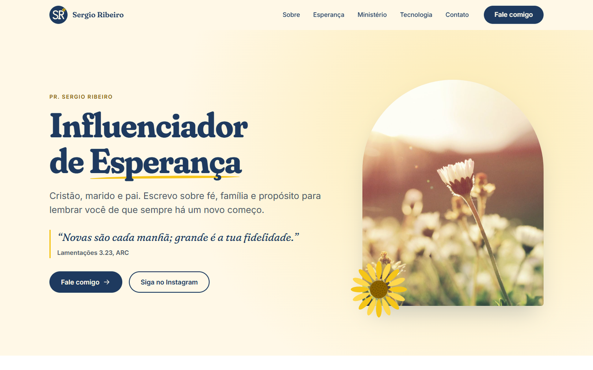
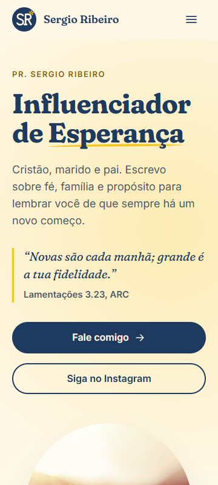

<div align="center">

# 🌼 Pr. Sergio Ribeiro

### Site pessoal · fé, família e esperança

*"Influenciador de Esperança"*


**[🌐 Ver online](https://sergioribeirosilva.github.io/EsquadraoPixel/sergio-ribeiro/)**

</div>

<table>
  <tr>
    <td width="74%"></td>
    <td width="26%"></td>
  </tr>
  <tr>
    <td align="center"><sub>Desktop · 1280 px</sub></td>
    <td align="center"><sub>Celular · 360 px</sub></td>
  </tr>
</table>

---

## 📌 Sobre

Site pessoal do **Pr. Sergio Ribeiro** ([@pr.sergioribeiro](https://www.instagram.com/pr.sergioribeiro/)), criado a partir da leitura pública do perfil do Instagram, numa tarefa agendada para as 4h da manhã. Ele apresenta a fé, a família e o propósito de "levar esperança", o ministério de homens, a atuação em tecnologia e as pontes com outras comunidades, e convida o visitante a conversar e a seguir no Instagram.

| | |
|---|---|
| **Pedido original** | "Acesse meu Instagram pr.sergioribeiro e crie um site utilizando o Esquadrão Pixel." |
| **Tipo** | Site pessoal / ministério |
| **Público** | Membros e amigos da igreja, quem busca uma palavra de esperança e contatos profissionais |
| **Tom de voz** | Caloroso, esperançoso e próximo, como no Instagram; o 🌼 como único emoji |
| **CTA principal** | Fale comigo (WhatsApp) |
| **CTA secundário** | Siga no Instagram |

---

## 🧭 Seções

1. **Hero editorial**: "Influenciador de Esperança", com a palavra *Esperança* sublinhada por uma pincelada amarela, versículo (Lm 3.22-23) e CTAs
2. **Sobre**: *"Fé em casa, esperança na rua"*, com fé e família
3. **Palavra para hoje**: versículo e reflexão curta
4. **Ministério**: *"Homens que caminham juntos"*
5. **Tecnologia**: *"Fé e tecnologia no mesmo propósito"*
6. **Pontes**: *"Amizade que atravessa fronteiras"*
7. **Instagram**: convite para seguir @pr.sergioribeiro
8. **Contato**: *"Vamos conversar?"* e rodapé

---

## 🎨 Design system

**Conceito: "Luz da manhã".** Editorial acolhedor em creme e azul-profundo, com a **margarida 🌼** como único gesto gráfico e o amarelo-sol só como acento.

| Cor | Token | Hex | Uso |
|:-:|---|---|---|
|  | `--color-azul` | `#1E3A5F` | Títulos, botões e fundos escuros |
|  | `--color-azul-noite` | `#132840` | Rodapé e faixas escuras |
|  | `--color-amarelo` | `#F5C518` | Acento: pincelada, margarida |
|  | `--color-dourado` | `#8A6100` | Eyebrows e detalhes sobre o creme |
|  | `--color-creme` | `#FFF8E7` | Fundo principal |
|  | `--color-areia` | `#F7EBCF` | Fundos de seção |
|  | `--color-texto` | `#1F2937` | Texto |

**Tipografia:** [Fraunces](https://fonts.google.com/specimen/Fraunces) nos títulos e versículos e [Inter](https://fonts.google.com/specimen/Inter) no texto (Google Fonts, `display=swap`).

**Recursos de interface:**
- 🖌️ Pincelada amarela em SVG sob a palavra *Esperança* (decorativa, `aria-hidden`)
- 📌 Barra fixa no celular com os botões de contato, que aparece e some conforme a rolagem
- 🍔 Menu acessível, com `Esc` para fechar e o foco devolvido ao botão
- ♿ Rótulos dos botões iguais ao texto visível (WCAG 2.5.3), corrigidos no ciclo 2
- 🔗 Links ainda sem endereço real ficam sem link ativo, em vez de apontar para lugar nenhum

---

## 📊 Avaliação

**Decisão final: ✅ APROVADO no ciclo 2 de 3**, com média **4,71**.

| Critério | Nota |
|---|:-:|
| Aderência ao briefing | ⭐⭐⭐⭐⭐ 5 |
| Hierarquia e clareza | ⭐⭐⭐⭐⭐ 5 |
| Estética moderna | ⭐⭐⭐⭐ 4 |
| Coerência com o design | ⭐⭐⭐⭐⭐ 5 |
| Qualidade do texto | ⭐⭐⭐⭐⭐ 5 |
| Imagens e assets | ⭐⭐⭐⭐ 4 |
| Experiência mobile | ⭐⭐⭐⭐⭐ 5 |

**Lighthouse (celular, ciclo 2):** desempenho **92** · acessibilidade **100** · boas práticas **100** · SEO **100** · LCP 3,2 s · CLS 0

Relatórios completos: [`inspecao-visual.md`](inspecao-visual.md) · [`avaliacao-tecnica.md`](avaliacao-tecnica.md) · [`avaliacao.md`](avaliacao.md) · [`capturas/`](capturas/)

---

## 🚀 Como abrir

Online: **https://sergioribeirosilva.github.io/EsquadraoPixel/sergio-ribeiro/**

```bash
cd projetos/sergio-ribeiro/site
# duplo clique em index.html, ou:
python -m http.server 8080   # http://localhost:8080
```

A pasta [`site/`](site/) tem todos os assets dentro dela e pode ser publicada sozinha.

---

## 📁 Arquivos do projeto

| Arquivo | Etapa | Conteúdo |
|---|---|---|
| [`briefing.md`](briefing.md) | 0 | O que foi lido do Instagram e as premissas |
| [`entrevista.md`](entrevista.md) | 0b | Perguntas guardadas para o fim (tarefa feita de madrugada) |
| [`dados-negocio.md`](dados-negocio.md) | 0b | Contatos **provisórios**, marcados como pendentes |
| [`pesquisa.md`](pesquisa.md) | 1 | Referências e sugestões de versículos |
| [`design.md`](design.md) | 2 | Design system e layout de cada seção |
| [`conteudo.md`](conteudo.md) | 3 | Toda a copy do site, com textos alternativos |
| [`imagens.md`](imagens.md) | 4 | Créditos e licenças das fotos |
| [`site/`](site/) | 5 | `index.html`, `styles.css`, `script.js`, [`CHANGELOG.md`](site/CHANGELOG.md) |

---

## ⚠️ Pendências antes de publicar

- [ ] **WhatsApp e e-mail reais** (hoje fictícios em 7 links e no card de contato, marcados com `<!-- PENDENTE -->`)
- [ ] **JSON-LD**: trocar ou remover `telephone`, `email` e `addressLocality`
- [ ] **Cidade** (Brasília/DF) a confirmar
- [ ] **AD Catedral Baleia**: autorização para citar e o papel exato no ministério de homens (há texto alternativo pronto no `conteudo.md`)
- [ ] **Tecnologia**: área ou função e links de LinkedIn, portfólio ou GitHub
- [ ] **Mônica**: autorização para aparecer pelo nome
- [ ] **Fotos**: retrato do Sergio no lugar de `retrato-placeholder.jpg` e foto real do ministério, com autorização
- [ ] **Domínio**: URL absoluta no `og:image`, `og:url` e `canonical`

---

## 📸 Créditos

As fotos vêm de Unsplash e Wikimedia Commons (Unsplash License e CC0). Os autores estão em [`imagens.md`](imagens.md). O retrato e as fotos do ministério são ilustrativos. Os SVGs, como a margarida e a pincelada, são originais.

<div align="center"><sub>Parte do <a href="../../README.md">Esquadrão Pixel</a></sub></div>
