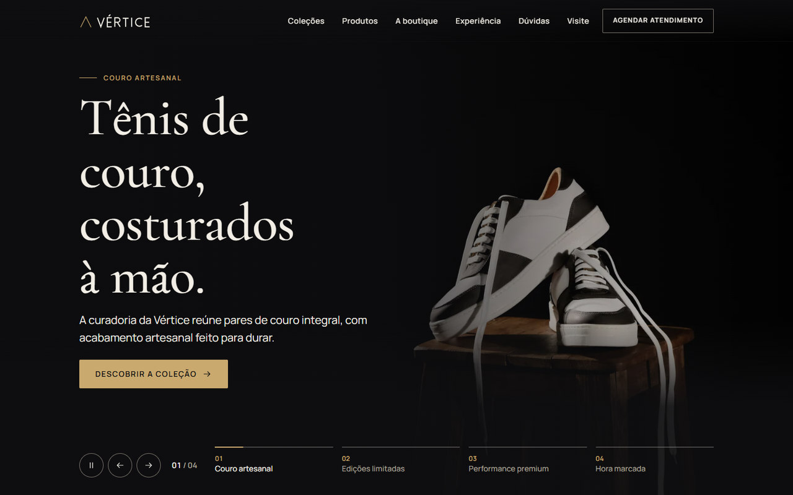
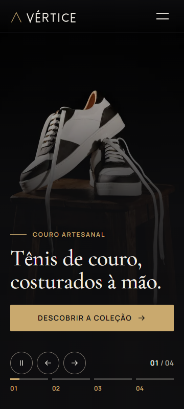

<div align="center">

# 👟 Vértice Sneakers

### Boutique de tênis de alto padrão, com atendimento com hora marcada

*"Tênis de couro, costurados à mão."*


**[🌐 Ver online](https://sergioribeirosilva.github.io/EsquadraoPixel/vertice-sneakers/)**

</div>

<table>
  <tr>
    <td width="74%"></td>
    <td width="26%"></td>
  </tr>
  <tr>
    <td align="center"><sub>Desktop · 1280 px</sub></td>
    <td align="center"><sub>Celular · 360 px</sub></td>
  </tr>
</table>

---

## 📌 Sobre

Landing page de uma **boutique de tênis e calçados de alto padrão**. Todos os dados são fictícios, a pedido do usuário. O visual é **escuro e editorial** ("vitrine noturna"): fundo quase preto, títulos serifados de alto contraste e um único acento champanhe. O objetivo é transmitir exclusividade e levar o visitante a **agendar um atendimento personalizado pelo WhatsApp** ou a visitar a loja.

O pedido central foi um **carrossel com pelo menos 4 imagens no hero**. Ele tem 4 slides em tela cheia e segue o padrão de carrossel com abas do W3C (APG):
- O botão de pausa é o primeiro foco, e há setas, contador "01 / 04", barra de progresso e abas com o nome de cada coleção.
- Funciona por teclado (← → Home End) e por toque (swipe).
- O autoplay avança a cada 7 s em todas as larguras, para quando o mouse ou o foco está no carrossel e fica desligado com `prefers-reduced-motion`.
- Cada slide tem recortes 16:9 e 9:16 em WebP + JPEG. O slide 1 carrega com `fetchpriority="high"` e os slides 2 a 4 com lazy-load.

| | |
|---|---|
| **Público** | Adultos de 22 a 50 anos, renda alta, interessados em moda, design e edições limitadas; colecionadores |
| **Tom de voz** | Sofisticado, confiante e conciso, com toques de exclusividade |
| **CTA principal** | Agendar atendimento (formulário que monta a mensagem do WhatsApp) |
| **CTA secundário** | Reservar um par pelo WhatsApp / Descobrir a coleção |

---

## 🧭 Seções

1. **Hero em carrossel**, com 4 slides: Couro artesanal, Edições limitadas, Performance premium e Hora marcada
2. **Coleções**: "Quatro caminhos para o mesmo cuidado." (mosaico)
3. **Produtos**: "Escolhidos um a um.", com 8 tênis de R$ 1.390 a R$ 4.900 e filtro por coleção
4. **Diferenciais**: "O que vem com cada par." (curadoria, autenticidade, atendimento, pós-venda)
5. **A boutique**: "Um tênis merece o cuidado de um sapato sob medida." (a única faixa clara)
6. **Experiência**: "Sua visita, do seu jeito.", com linha do tempo e formulário de agendamento
7. **Depoimentos**: "Quem já viveu a experiência." (exemplos)
8. **Perguntas frequentes**: "Antes da sua visita."
9. **Visite**: "Um endereço para escolher com calma.", com link de mapa genérico (sem iframe, porque o endereço é fictício)
10. **CTA final**: "Seu próximo par começa com uma conversa."
11. **Rodapé** com navegação, contato, horário, créditos das fotos e aviso de site de demonstração

---

## 🎨 Design system

**Conceito:** vitrine noturna editorial. Muito respiro, fotos de produto com luz de estúdio e animações sutis.

| Cor | Token | Hex | Uso |
|:-:|---|---|---|
|  | `--cor-fundo` | `#0E0E10` | Fundo principal |
|  | `--cor-superficie` | `#1A1A1D` | Faixas alternadas e cartões |
|  | `--cor-texto` | `#F2EEE6` | Texto e títulos (16,7:1) |
|  | `--cor-texto-suave` | `#A8A29A` | Legendas e abas inativas (7,6:1) |
|  | `--cor-acento` | `#C9A96E` | CTA, preços, números, foco (8,6:1) |
|  | `--cor-osso` | `#ECE6DA` | Fundo da seção "A boutique" |
|  | `--cor-bronze` | `#7A5A2B` | Acento sobre a faixa clara (5,1:1) |

**Tipografia:** [Cormorant Garamond](https://fonts.google.com/specimen/Cormorant+Garamond) nos títulos e [Manrope](https://fonts.google.com/specimen/Manrope) no texto. As vogais acentuadas minúsculas dos títulos vêm de pequenos recortes da [EB Garamond](https://fonts.google.com/specimen/EB+Garamond) (OFL, cerca de 2 KB cada), porque o acento da Cormorant fica solto acima da letra.

---

## 📊 Avaliação

**Decisão final: ✅ APROVADO no ciclo 2 de 3**, com média **4,57** (no ciclo 1 foi 3,86, com ITERAR).

| Critério | Ciclo 1 | Ciclo 2 |
|---|:-:|:-:|
| Aderência ao briefing | 4 | ⭐⭐⭐⭐⭐ 5 |
| Hierarquia e clareza | 5 | ⭐⭐⭐⭐⭐ 5 |
| Estética moderna | 4 | ⭐⭐⭐⭐⭐ 5 |
| Coerência com o design | 4 | ⭐⭐⭐⭐ 4 |
| Qualidade do texto | 5 | ⭐⭐⭐⭐⭐ 5 |
| Imagens e assets | 3 | ⭐⭐⭐⭐ 4 |
| Experiência mobile | 2 | ⭐⭐⭐⭐ 4 |

**O que mudou no ciclo 2:**
- O menu do celular e do tablet deixou de abrir cortado depois de rolar: o `backdrop-filter` saiu do cabeçalho e foi para um `::before`.
- Os números das abas do carrossel e o "@verticesneakers" do Instagram passaram a fazer parte do nome acessível (WCAG 2.5.3).
- Os rádios do "Período" voltaram a ser redondos.
- O `h1` ficou fixo fora dos slides.
- As fotos da faixa da boutique e da seção Visite foram trocadas por interiores com tênis.
- Os acentos dos títulos foram corrigidos.
- Entraram `canonical`, logo PNG no JSON-LD, alvos de 44 px e um menu sem JavaScript.

**Lighthouse (ciclo 2):** celular **94** / 100 / 100 / 100 · desktop **100** / 100 / 100 / 100. A queda de 98 para 94 no celular é variação da medição: num teste A/B com 7 rodadas de cada versão, a diferença entre rodadas foi maior que a diferença entre as versões.

Relatórios completos: [`inspecao-visual.md`](inspecao-visual.md) · [`avaliacao-tecnica.md`](avaliacao-tecnica.md) · [`avaliacao.md`](avaliacao.md) · [`capturas/`](capturas/)

---

## 🚀 Como abrir

Online: **https://sergioribeirosilva.github.io/EsquadraoPixel/vertice-sneakers/**

```bash
cd projetos/vertice-sneakers/site
# duplo clique em index.html, ou:
python -m http.server 8080   # http://localhost:8080
```

A pasta [`site/`](site/) tem todos os assets dentro dela e pode ser publicada sozinha.

---

## 📁 Arquivos do projeto

| Arquivo | Etapa | Conteúdo |
|---|---|---|
| [`briefing.md`](briefing.md) | 0 | Pedido e premissas (todos os dados fictícios) |
| [`dados-negocio.md`](dados-negocio.md) | 0b | Dados de contato fictícios (sem entrevista) |
| [`pesquisa.md`](pesquisa.md) | 1 | Referências, padrão de carrossel APG e fontes de fotos |
| [`design.md`](design.md) | 2 | Design system |
| [`conteudo.md`](conteudo.md) | 3 | Toda a copy, com revisões |
| [`imagens.md`](imagens.md) | 4 | Créditos e licenças |
| [`site/`](site/) | 5 | `index.html`, `styles.css`, `script.js`, [`CHANGELOG.md`](site/CHANGELOG.md), `assets/` |
| [`fontes-svg/`](fontes-svg/) | — | Variante do logo que o site não carrega |
| [`inspecao-visual.md`](inspecao-visual.md) | 6 | Inspeção no navegador, ciclos 1 e 2 |
| [`avaliacao-tecnica.md`](avaliacao-tecnica.md) | 7 | Avaliação técnica: REPROVADO no ciclo 1, APROVADO no ciclo 2 |
| [`avaliacao.md`](avaliacao.md) | 8 | Decisão: ITERAR no ciclo 1, APROVADO no ciclo 2 |

---

## ⚠️ Para virar um site real

- [ ] *(opcional)* No celular, o cadarço do slide 3 passa atrás do logo; dá para ajustar o `object-position`
- [ ] *(opcional)* O card "Couro artesanal" mostra um sapato social, e as fotos dos produtos 02 e 05 têm fundo diferente das outras
- [ ] Trocar os dados fictícios: Alameda das Palmeiras, 1200; WhatsApp `(00) 90000-0000`; e-mail, Instagram e horários
- [ ] Trocar as políticas de demonstração (troca em 30 dias, envio, parcelamento, higienização cortesia)
- [ ] Coordenadas reais, para o mapa interativo
- [ ] Fotos reais dos produtos, da loja e dos clientes (hoje de bancos de imagens)
- [ ] Preços e depoimentos reais, e tirar o aviso de demonstração
- [ ] Domínio próprio (atualizar `canonical` e `og:url`)

---

## 📸 Créditos

As fotos vêm do Unsplash (licença grátis, nenhuma Unsplash+) e do Pexels, e são ilustrativas. Nenhuma tem logo de marca legível. O logo e o favicon são SVGs originais. Os recortes da EB Garamond seguem a SIL Open Font License ([`site/assets/fontes/OFL-EB-Garamond.txt`](site/assets/fontes/OFL-EB-Garamond.txt)). Os detalhes estão em [`imagens.md`](imagens.md).

<div align="center"><sub>Parte do <a href="../../README.md">Esquadrão Pixel</a></sub></div>
